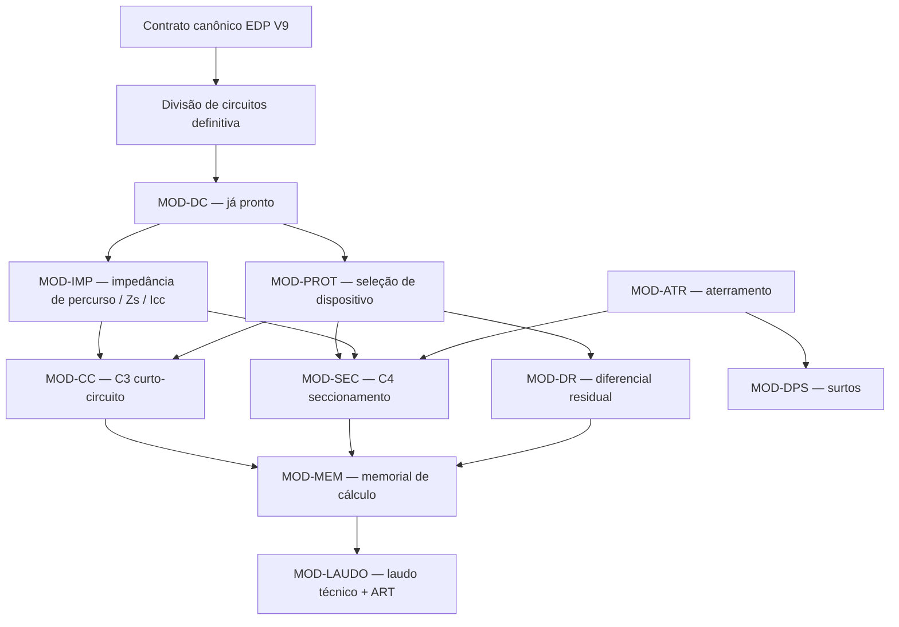

# Varredura completa do SIE e ordem lógica dos próximos módulos

**Data:** 2026-07-28
**Autor:** Atlas (@analyst)
**Natureza:** exclusivamente diagnóstica e de recomendação — nenhum arquivo de código foi alterado
**Repositório auditado:** `sistema-de-instala-es-el-tricas-sie-main` (submodule) + `docs/` do projeto pai
**Insumos anteriores:** auditoria de efetividade 2026-07-07, auditoria NBR5410/EDP 2026-06-21, brainstorm de novos módulos 2026-07-07

---

## 1. Resultado executivo

Desde a auditoria de 2026-07-07 o SIE avançou de forma expressiva no **elo de dimensionamento de condutores**: MOD-DC (DC-1…DC-11), AUTO-OTI (otimização de seção), MOD-DC-HYBRID (overrides por circuito) e MOD-QT (queda de tensão, C5) saíram do zero para código real com testes.

O que **não** avançou é o que define se o SIE emite um projeto entregável:

1. **A matriz de critérios NBR do MOD-DC não fecha.** C3 (curto-circuito) e C4 (seccionamento automático) são **mocks literais** em produção — `icc_presumida_a < 5000` e `tempo_atuacao_s <= 0,4`. Pior: `Icc` e `tempo de atuação` chegam como **parâmetros de entrada**, não como grandezas calculadas. Não existe cálculo de impedância de percurso no sistema.
2. **Não existe seleção de dispositivo de proteção.** `motor-protecao.ts` é uma sugestão provisória: série fixa 6…63 A e `I2 = 1,45 · In` hardcoded. Zero ocorrências de curva tempo-corrente, `Icu`, capacidade de interrupção ou seletividade no código.
3. **A divisão de circuitos definitiva (P0 acordado em 2026-07-07) segue aberta.** `derivar-circuitos.ts` continua se autodeclarando "Mapeador provisório … enquanto a Divisão de Circuitos ainda não existe".
4. **A certificação normativa NBR não avançou.** As 14 entradas de `catalog.data.json` permanecem 100 % `status_verificacao: "VERIFICAR"`.
5. **Não existe memorial de cálculo nem laudo.** O `servico-relatorio-projeto.ts` existe, mas suas seções são de cobertura/diagnóstico (`project_summary`, `conformidade_nbr5410`, `edp_*`, `correntes`, `historico_auditoria`) — não há seção de dimensionamento, não há memorial, não há rota de UI que o exponha.

**Consequência para a ordenação:** os próximos módulos não são uma lista de desejos priorizável por valor. A física da instalação impõe uma cadeia de dependências. Curto-circuito exige impedância; seccionamento exige impedância *e* curva de dispositivo; laudo exige que todos os critérios tenham resultado real. Inverter essa ordem produz módulos que só sabem devolver `PENDENTE`.

---

## 2. Inventário verificado — estado real em 2026-07-28

Legenda: ✅ implementado · 🟡 parcial/provisório · 🔵 em revisão · ❌ inexistente

| # | Elo / módulo | Status | Evidência |
|---|---|---|---|
| 1 | Levantamento de cargas (iluminação, TUG, TUE, bancadas) | ✅ | `domain/calculo/{iluminacao,tomadas,cargas-adicionais,motor}.ts` |
| 2 | Demanda EDP-SP (grupos a–i, Tabelas 005–015) | ✅ | `domain/distribuidora/edp-sp/motor-demanda.ts` + 9 `tabela_0XX.data.json` |
| 3 | Categoria/subcategoria do padrão de entrada (U/D/T) | 🟡 | `seletor-categoria.ts`, `seletor-subcategoria.ts` — em reestruturação por EDP V9 |
| 3b | **Padrão compatível EDP V9** (contrato canônico) | 🔵 | PRD + ADR + gates prontos; QA preflight liberou só o Pacote 1; **implementação não iniciada** |
| 4 | Divisão de circuitos | 🟡 | `divisao-circuitos.ts` (plano/manual/diff) sobre `derivar-circuitos.ts` **ainda provisório** |
| 5 | Corrente de projeto (IB) + balanceamento de fases | ✅ | `corrente-projeto.ts`, `corrente-circuitos.ts`, `balanceamento-fases.ts` |
| 6 | **MOD-DC** — dimensionamento de condutores | ✅ | 6 motores: capacidade-corrente (C1), sobrecarga (C2), seção-mínima, neutro, PE/PEN, proteção-sugestão |
| 6b | **AUTO-OTI** — auto-otimização de seção | ✅ | `domain/calculo/otimizador.ts` + `OtimizarCondutorModal.tsx`; stories 1.1/1.2 Done |
| 6c | **MOD-DC-HYBRID** — overrides por circuito | 🔵 | 4 stories implementadas, todas em `InReview`; migration `0010` aplicada |
| 7 | **MOD-QT** — queda de tensão (C5) | 🔵 | motor real + simulador de cenários; MOD-QT-2-01 `InReview`, 2-02 `Ready` |
| 8 | **MOD-CC** — curto-circuito (C3) | ❌ | `routes/api/v1/modulos.mod-cc.validar.ts:95` — mock `icc < 5000`; `TODO: substituir por serviço real` |
| 9 | **MOD-SEC** — seccionamento automático (C4) | ❌ | `routes/api/v1/modulos.mod-sec.validar.ts:105` — mock `tempo <= 0,4 s` |
| 10 | Impedância de percurso / `Zs` / `Icc` calculada | ❌ | não existe; `Icc` e `tempo_atuacao_s` são *inputs* dos endpoints |
| 11 | Seleção de dispositivo de proteção (MOD-PROT) | ❌ | `OrigemIn: "MOD-PROT"` já declarado em `contratos.ts:12`, **sem módulo por trás** |
| 12 | DR (dispositivo diferencial residual) | ❌ | só como checklist declaratório em `ConformidadeNBR5410Help.tsx` |
| 13 | DPS (proteção contra surtos) | ❌ | zero ocorrências no código |
| 14 | Aterramento / equipotencialização | ❌ | `esquema_aterramento` é campo de entrada; não há dimensionamento de eletrodo/BEP |
| 15 | Diagrama unifilar + exportação | ✅ | `domain/unifilar/` + `server/unifilar-export/` + pacote Python `export/sie_unifilar_export` |
| 16 | Relatório de projeto | 🟡 | `servico-relatorio-projeto.ts` + renderizador Markdown; **sem seção de dimensionamento e sem rota de UI** |
| 17 | Memorial de cálculo / laudo técnico / ART | ❌ | inexistente |
| — | Transversal: estados, auditoria imutável, conformidade NBR (checklist) | ✅ | `domain/estado/`, `eventos_auditoria`, `conformidade-nbr5410.ts` |
| — | Transversal: certificação normativa NBR | ❌ | 14/14 entradas de `catalog.data.json` em `VERIFICAR` |
| — | Transversal: hardening Supabase | 🟡 | 10 migrations em `docs/supabase/migrations/` + 4 no `supabase/migrations/` do pai; DB-01 (migrations não geridas pelo CLI) segue aberto |

### 2.1 Execução da suíte (2026-07-28)

```
npx vitest run  →  Test Files  1 failed | 124 passed (125)
                   Tests       815 passed (815)
                   Duration    859,45 s
```

Nenhum teste falha. A única suíte quebrada é **`tests/domain/calculo/derivar-circuitos.test.ts`, que tem 0 bytes** — arquivo vazio, `No test suite found in file`. Último commit a tocá-lo: `cb782d6` ("aplicar identidade visual em todas as páginas"), ou seja, foi esvaziado por acidente em um commit de UI e ninguém percebeu.

O achado é relevante para a ordenação: **o módulo que continua provisório e é o bloqueador P0 da cadeia é exatamente o que está sem cobertura alguma**. A divisão de circuitos definitiva (Onda 0.3) precisa começar restaurando esse arquivo — a suíte atual não protege nenhuma regressão nesse ponto.

Comparativo com a auditoria de 2026-07-07: 429 → **815 testes** (+90 %), e a falha de rastreabilidade em `quantidade-analise.test.ts:45` (override manual contaminando `carga_automatica_va`) **foi corrigida**.

---

## 3. O grafo de dependências que define a ordem



Duas leituras importantes desse grafo:

- **MOD-IMP é o nó não escrito de maior grau.** Ele alimenta C3 e C4 simultaneamente. Enquanto ele não existir, MOD-CC e MOD-SEC só podem ser mocks — foi exatamente o que aconteceu.
- **MOD-PROT é o desbloqueador de maior alcance.** Ele alimenta C3, C4 e o DR, e já tem gancho reservado no contrato (`OrigemIn: "MOD-PROT"`). É o próximo módulo com melhor relação desbloqueio/esforço.

---

## 4. Ordem lógica recomendada

### Onda 0 — Fechar o que está aberto (pré-condição, não módulo novo)

Sem isso, qualquer módulo novo é construído sobre estado instável.

| Item | Ação | Por que agora |
|---|---|---|
| **0.1** | QA gate de MOD-DC-HYBRID 1–4, MOD-QT-2-01, MOD-QT-2-02 | 6 stories em `InReview`/`Ready` bloqueiam o release candidate; MOD-QT é o único critério downstream com motor real |
| **0.2** | EDP V9 — Pacote 1 (modelo normativo + catálogo estrutural) | O contrato canônico de fornecimento define tensão e topologia; divisão de circuitos e dimensionamento consomem isso. Fazer depois = retrabalho garantido |
| **0.3** | Divisão de circuitos definitiva (substituir `derivar-circuitos` provisório) | É o P0 acordado em 2026-07-07 e nunca fechado. Todo módulo a jusante recebe circuitos deste mapeador. **Começar restaurando `tests/domain/calculo/derivar-circuitos.test.ts`, hoje vazio (0 bytes)** — sem isso a reescrita ocorre sem rede de proteção |

### Onda 1 — Fechar a matriz de critérios C1…C6

Objetivo: eliminar `ERR-DIMENSIONAMENTO-PENDENTE` de forma legítima.

| Ordem | Módulo | Entrega | Depende de |
|---|---|---|---|
| **1.1** | **MOD-PROT** — seleção de dispositivo de proteção | Curvas B/C/D, séries normalizadas IEC 60898/60947, `In`, `I2`, capacidade de interrupção `Icu`. Substitui a sugestão provisória de `motor-protecao.ts` | MOD-DC (pronto) |
| **1.2** | **MOD-IMP** — impedância de percurso | `Zs` do ponto de entrega até cada circuito terminal, `Icc` presumida no quadro e na extremidade. Reaproveita `tabela-impedancia.ts` e `resistividade.ts` já criados pelo MOD-QT | Onda 0.3, MOD-QT |
| **1.3** | **MOD-CC** real — C3 | Integridade térmica `I²t ≤ k²S²`, substituindo o mock | 1.1 + 1.2 |
| **1.4** | **MOD-SEC** real — C4 | Tempo de seccionamento vs. Tabelas 25/26, cruzando `Zs` com a curva do dispositivo | 1.1 + 1.2 |

> Recomendação de escopo: seguir a ideia 7 do brainstorm — **MOD-PROT como validador antes de gerador**. Valida `IB ≤ In ≤ IZ` e `I2 ≤ 1,45 · IZ` sobre escolha do engenheiro, e só depois passa a sugerir automaticamente. Reduz exposição de responsabilidade técnica.

### Onda 2 — Proteção de pessoas e da instalação

Independente da Onda 1 no cálculo, mas depende de MOD-PROT no contrato.

| Ordem | Módulo | Racional |
|---|---|---|
| **2.1** | **MOD-DR** — diferencial residual | Regras de obrigatoriedade (NBR 5410 §5.1.3.2) são determinísticas. Alto valor percebido, baixo custo. Hoje o DR só existe como checklist |
| **2.2** | **MOD-ATR** — aterramento e equipotencialização | Eletrodo, condutor de aterramento, BEP/equipotencialização suplementar. Fecha o esquema TN/TT que hoje é só um campo de entrada e é insumo de qualidade para o `Zs` do MOD-IMP |
| **2.3** | **MOD-DPS** — proteção contra surtos | Classe/nível conforme esquema de aterramento e zona. Depende de 2.2 |

### Onda 3 — Consolidação do entregável (o que o cliente paga)

| Ordem | Módulo | Racional |
|---|---|---|
| **3.1** | **MOD-MEM** — memorial de cálculo | Colhe o rastreio que MOD-DC/QT/CC/SEC **já produzem** (`baseadoEm`, `parametrosUsados`, `RastreioQuedaTensao`). Custo marginal se feito depois da Onda 1; caro se feito antes |
| **3.2** | **MOD-LAUDO** — laudo técnico | Documento ABNT + vínculo com ART/TRT. Estende `servico-relatorio-projeto.ts` com seções de dimensionamento e proteção, e cria a rota de UI que hoje não existe |
| **3.3** | Exportação consolidada | PDF/planilha do laudo, aproveitando o pipeline de exportação do unifilar já operante |

### Onda 4 — Qualidade normativa e infraestrutura (paralelizável com 1–3)

| Ordem | Item | Racional |
|---|---|---|
| **4.1** | **Certificação NBR** — 14 `VERIFICAR` → `VERIFICADO` | Replicar o processo do catálogo EDP (única área `VERIFICADO`). É o maior risco do projeto, e é normativo, não técnico |
| **4.2** | **Suíte de casos dourados** | 20–30 casos resolvidos por engenheiro como testes de aceitação. Deve **preceder** cada módulo da Onda 1, não sucedê-lo |
| **4.3** | **Hardening Supabase** — DB-01…DB-11 | Migrations sob o Supabase CLI, CHECK constraints, transação no agregado. Fazer junto com o primeiro módulo novo, para que ele nasça no padrão certo |

### Onda 5 — Diferenciais competitivos

| Ordem | Módulo | Racional |
|---|---|---|
| **5.1** | **Explicador normativo** | Cada resultado clicável abre seção/tabela/linha da NBR. Transforma o SIE em ferramenta de defesa técnica perante fiscalização |
| **5.2** | **Simulação de cenários ampliada** | Já existe `simulador-cenarios.ts` para queda de tensão. Generalizar para material, método de instalação e temperatura é quase gratuito sobre motores puros |
| **5.3** | **Multi-distribuidora** | Hoje só EDP-SP. A arquitetura `domain/distribuidora/{concessionaria}/` já suporta; é replicação de catálogo |

---

## 5. Sequência condensada

```
Onda 0  →  QA pendente · EDP V9 Pacote 1 · Divisão de circuitos definitiva
Onda 1  →  MOD-PROT  →  MOD-IMP  →  MOD-CC (C3)  →  MOD-SEC (C4)
Onda 2  →  MOD-DR  →  MOD-ATR  →  MOD-DPS
Onda 3  →  MOD-MEM  →  MOD-LAUDO  →  Exportação
Onda 4  →  Certificação NBR · Casos dourados · Hardening Supabase   [paralelo]
Onda 5  →  Explicador normativo · Simulação ampliada · Multi-distribuidora
```

---

## 6. Riscos da ordenação

| Risco | Consequência | Mitigação |
|---|---|---|
| Implementar MOD-CC/MOD-SEC antes de MOD-IMP | Módulos que só sabem devolver `PENDENTE` — repete exatamente o erro dos mocks atuais | Tratar MOD-IMP como pré-requisito formal, não como refinamento |
| Iniciar laudo antes de fechar C3/C4 | Laudo emitido com critérios não verificados: risco de responsabilidade técnica real | Gate: MOD-LAUDO só é liberado com C1…C6 todos resolvidos |
| Deixar a certificação NBR para o fim | Toda a Onda 1 se apoia em tabelas não certificadas; recertificar depois invalida resultados já persistidos | Rodar 4.1 em paralelo, tabela a tabela, na ordem em que cada módulo a consome |
| Pular a Onda 0.2 (EDP V9) | Contrato de tensão/topologia muda no meio da Onda 1 → retrabalho em cascata | Respeitar o QA preflight vigente; Pacote 1 antes de qualquer módulo novo |
| Acumular stories em `InReview` | 6 stories abertas hoje; a dívida de QA cresce mais rápido que a de código | Fechar Onda 0.1 antes de abrir a Onda 1 |

---

## 7. Handoffs sugeridos

- **@pm (Morgan)** — converter as Ondas 1 e 2 em epics; MOD-PROT e MOD-IMP são candidatos naturais a epic conjunto
- **@architect (Aria)** — desenhar o contrato de MOD-IMP antes de qualquer código; ele é consumido por dois módulos e é o ponto de acoplamento mais sensível da Onda 1
- **@qa (Quinn)** — fechar os gates da Onda 0.1 e definir os casos dourados (4.2) antes do início da Onda 1
- **@data-engineer (Dara)** — planejar 4.3 junto com a primeira migration da Onda 1

---

**Referências de origem**
- `docs/audits/2026-07-07-auditoria-efetividade-eficacia-roadmap/AUDITORIA-EFETIVIDADE-EFICACIA-ROADMAP.md`
- `docs/research/2026-07-07-brainstorm-novos-modulos/BRAINSTORM-NOVOS-MODULOS-DIMENSIONAMENTO.md`
- `docs/PLANO-REESTRUTURACAO-PADRAO-COMPATIVEL-EDP-V9.md`
- `docs/EXECUCAO-CORRECAO-PADRAO-COMPATIVEL-EDP-V9.md`
- `docs/roadmap/ROADMAP-dimensionador-hybrid.md`
- `sistema-de-instala-es-el-tricas-sie-main/docs/supabase/DB-AUDIT.md`
