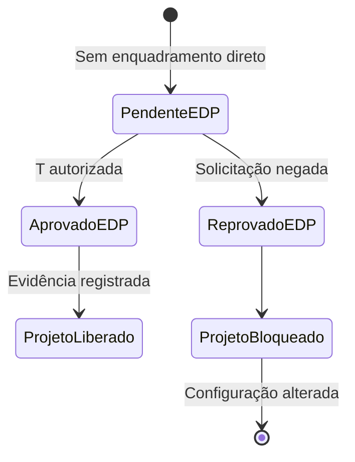

# Parecer Técnico — GN-01 e DP-03 — EDP V9

> **Natureza do documento:** parecer técnico interno para decisão dos gates do SIE  
> **Estado:** APROVADO para os gates GN-01 e DP-03, com ressalvas operacionais  
> **Projeto:** SIE — Sistema de Instalações Elétricas  
> **Norma analisada:** PT.DT.PDN.00068, versão 09, vigência iniciada em 14/04/2026  
> **Concessionária:** EDP São Paulo

## 1. Parecer técnico e fundamento da decisão

Este parecer é elaborado sob a perspectiva de um engenheiro eletricista sênior,
com foco em instalações elétricas de baixa tensão, enquadramento de unidades
consumidoras, análise normativa, validação de regras de negócio e auditoria de
motores de cálculo.

A conclusão decorre do exame técnico da PT.DT.PDN.00068 V9, da interpretação
dos seus limites de potência, sistemas de fornecimento, quantidade de fases,
tensão, tabelas, notas e efeitos funcionais no SIE. O PDF original é a fonte
normativa principal; a transcrição é utilizada apenas para localização e
conferência textual.

O parecer possui fundamentação própria e é apresentado como decisão técnica de
engenharia, com premissas, evidências, critérios, consequências operacionais e
limites de aplicação explicitamente registrados.

Nesta versão, a decisão dos gates é exclusivamente técnica e funcional. Não
constituem requisitos de emissão, validação ou promoção deste parecer:

- nome de pessoa;
- registro profissional ou conselho;
- organização;
- data de revisão ou ratificação;
- assinatura;
- identificação pessoal; e
- execução ou reexecução de RV-01.

Os status `APROVADO` e `REPROVADO` referem-se somente à adequação da regra de
negócio, da interpretação normativa e do comportamento previsto para o SIE.
Eles não representam autorização da EDP São Paulo, aprovação de uma unidade
consumidora específica ou liberação automática de casos que dependam de
manifestação da concessionária.

## 2. Critério de aprovação e limites do parecer

Para este documento:

- `APROVADO` significa que o gate possui regra técnica definida, fundamento
  normativo rastreável e tratamento funcional suficiente para implementação no
  SIE;
- `REPROVADO` significa que o gate não possui base suficiente para ser usado
  na implementação ou contém inconsistência técnica não resolvida.

A aprovação dos gates autoriza a implementação das regras descritas neste
parecer. Não autoriza o sistema a atribuir automaticamente uma categoria de
fornecimento quando a PT.DT.PDN.00068 V9 exigir análise, confirmação ou estudo
da EDP.

## 3. Objeto e escopo

O presente documento examina:

- **GN-01:** enquadramento das cargas instaladas exatamente iguais a 12 kW e
  25 kW, distinguindo os sistemas estrela com neutro, 220/127 V, e delta com
  neutro, 240/120 V;
- **DP-03:** tratamento de instalações com equipamentos trifásicos que não se
  enquadram diretamente nas faixas textuais da categoria T;
- efeito da quantidade de fases e da compatibilidade de tensão sobre o
  enquadramento;
- alcance da Nota-03, relativa à solicitação de categoria superior;
- casos sujeitos a estudo técnico, confirmação ou decisão da EDP São Paulo;
- comportamento seguro a ser adotado pelo motor de regras do SIE enquanto não
  houver enquadramento normativo direto.

Não integram o escopo:

- dimensionamento completo do padrão de entrada;
- cálculo de demanda, corrente de projeto, curto-circuito ou queda de tensão;
- seleção final de condutores, eletrodutos, proteção, medição ou caixa;
- análise de uma unidade consumidora específica;
- aprovação de projeto pela EDP.

## 4. Documentos e evidências examinados

### 4.1 Documentos disponíveis

1. `PT.DT.PDN.00068_V9.pdf`, documento normativo original, 91 páginas;
2. `PT.DT.PDN.00068_V9_markdown_limpo.md`, transcrição destinada à pesquisa;
3. `GUIA-PARECER-TECNICO-GN-01-DP-03-EDP-V9.md`.

O PDF original foi a fonte normativa principal. A transcrição foi utilizada
somente como recurso de localização e conferência textual.

### 4.2 Documentos complementares

Os documentos abaixo podem ser usados como material de integração e
compatibilização do sistema, mas não são pré-requisitos para a atribuição dos
status dos gates deste parecer:

1. `docs/prd/PRD-PADRAO-COMPATIVEL-EDP-V9.md`;
2. `docs/PLANO-REESTRUTURACAO-PADRAO-COMPATIVEL-EDP-V9.md`.

A decisão dos gates GN-01 e DP-03 está fundamentada diretamente na
PT.DT.PDN.00068 V9, nas páginas e tabelas indicadas neste documento e na
coerência da regra funcional descrita para o SIE. Nenhum cadastro pessoal,
assinatura ou ciclo externo de revalidação é condição para esta decisão.

## 5. Base normativa e rastreabilidade

| Referência | Página do PDF | Conteúdo relevante | Aplicação neste parecer |
| --- | ---: | --- | --- |
| Seção 5.3.1 | 14 | Sistemas estrela com neutro, 220/127 V, e delta com neutro, 240/120 V | Obriga distinguir topologia e tensão |
| Nota da seção 5.3.1 | 14 | No delta com neutro, a fase de força, quarto fio, deve ser usada somente para cargas trifásicas | Confirma a necessidade de quatro fios para equipamento trifásico no sistema delta |
| Seção 5.3.2 | 14 | Fornecimento em baixa tensão para carga instalada igual ou inferior a 75 kW; acima desse valor, atendimento em tensão primária, ressalvada análise da EDP | Define o teto geral e o encaminhamento acima de 75 kW |
| Seção 5.3.3 | 14 | U = FN; D = FFN; T = FFFN | Define a capacidade de fases de cada modalidade |
| Seção 5.3.4, quadro de aplicações | 15 | U até 12 kW; D estrela acima de 12 até 25 kW; D delta acima de 12 até 75 kW; T estrela acima de 25 até 75 kW; T delta acima de 12 até 75 kW, somente com equipamentos trifásicos | Define os intervalos de GN-01 e os pisos textuais discutidos em DP-03 |
| Nota-01 | 15 | Equipamentos acima das potências-limite exigem estudo técnico detalhado para análise da EDP | Impede aceitação automática de equipamentos fora dos limites |
| Nota-02 | 15 | Motores acima dos limites das Tabelas 001 e 002 podem demandar solicitação de enquadramento acompanhada de estudo detalhado do motor e da partida | Impede classificação automática baseada apenas na potência total |
| Nota-03 | 15 | Cliente enquadrado em U pode desejar D; cliente enquadrado em D pode desejar T; a EDP poderá atender mediante taxa adicional | Autoriza solicitação, mas não concede reenquadramento automático |
| Tabela 001 | 31 | Categorias U e D, proteções, condutores, medição e limites de maior motor | Aplicável depois da definição de U ou D |
| Tabela 002 | 32 | Categorias T, proteções, condutores, medição e limites de maior motor | Aplicável depois da definição de T |

## 6. Premissas interpretativas

### 6.1 Grandeza utilizada nas fronteiras

As fronteiras de 12 kW, 25 kW e 75 kW da seção 5.3.4 referem-se à **carga
instalada**, e não à demanda calculada, à potência do maior equipamento ou à
corrente de demanda.

### 6.2 Significado dos operadores textuais

Para fins de interpretação inequívoca:

- “até X” inclui o valor X;
- “acima de X” exclui o valor X;
- “acima de X até Y” corresponde ao intervalo \(X < C \leq Y\), em que
  \(C\) é a carga instalada.

Consequentemente:

| Categoria e sistema | Intervalo textual direto |
| --- | --- |
| U — estrela ou delta | \(C \leq 12\ \text{kW}\) |
| D — estrela | \(12 < C \leq 25\ \text{kW}\) |
| D — delta | \(12 < C \leq 75\ \text{kW}\) |
| T — estrela | \(25 < C \leq 75\ \text{kW}\) |
| T — delta, havendo equipamento trifásico | \(12 < C \leq 75\ \text{kW}\) |

Esses intervalos somente produzem enquadramento direto quando a quantidade de
fases, a tensão nominal e as características dos equipamentos são compatíveis
com a modalidade.

### 6.3 Categoria de atendimento e compatibilidade do equipamento

A carga instalada, isoladamente, não resolve todos os casos. A seção 5.3.3
define:

- U como monofásica, FN;
- D como bifásica, FFN;
- T como trifásica, FFFN.

Assim, U e D não oferecem três fases. Uma carga ou equipamento efetivamente
trifásico não pode ser declarado compatível com U ou D apenas porque a carga
instalada se encontra no intervalo dessas categorias. Também não é admissível
alterar silenciosamente a tensão nominal, o número de fases ou a natureza do
equipamento para produzir um enquadramento.

## 7. Parecer técnico para GN-01

### 7.1 Matriz de decisão das fronteiras exatas

| Carga instalada | Sistema | Equipamento trifásico | Tratamento técnico |
| ---: | --- | --- | --- |
| 12 kW | Estrela 220/127 V | Não | Enquadramento direto em U, pois “até 12 kW” inclui 12 kW |
| 12 kW | Delta 240/120 V | Não | Enquadramento direto em U, pois “até 12 kW” inclui 12 kW |
| 12 kW | Estrela 220/127 V | Sim | Sem enquadramento direto: U é FN, D é FFN e T estrela exige carga acima de 25 kW |
| 12 kW | Delta 240/120 V | Sim | Sem enquadramento direto: U é FN e T delta exige carga acima de 12 kW |
| 25 kW | Estrela 220/127 V | Não | Enquadramento direto em D, pois o intervalo é \(12 < C \leq 25\) kW |
| 25 kW | Delta 240/120 V | Não | Enquadramento direto em D, pois o intervalo é \(12 < C \leq 75\) kW |
| 25 kW | Estrela 220/127 V | Sim | Sem enquadramento direto: D é FFN e T estrela exige carga acima de 25 kW |
| 25 kW | Delta 240/120 V | Sim | Enquadramento direto em T, pois há equipamento trifásico e \(12 < C \leq 75\) kW |

### 7.2 Conclusão técnica para exatamente 12 kW

Sem equipamento trifásico ou outra condição impeditiva, uma instalação com
carga instalada exatamente igual a 12 kW pertence à categoria U tanto no
sistema estrela quanto no sistema delta. O fundamento é a expressão “até
12 kW”, constante do quadro da seção 5.3.4, página 15, que inclui o ponto de
fronteira.

A presença de equipamento trifásico impede transformar essa conclusão em
enquadramento automático. U é FN e não fornece três fases; T exige carga
**acima** de 25 kW no sistema estrela e **acima** de 12 kW no sistema delta.
Logo, exatamente 12 kW com equipamento trifásico constitui lacuna de
enquadramento direto e deve ser submetido à EDP São Paulo.

### 7.3 Conclusão técnica para exatamente 25 kW

No sistema estrela, sem equipamento trifásico, exatamente 25 kW pertence à
categoria D, pois o limite superior “até 25 kW” é inclusivo. Não pertence a T,
cuja aplicação começa **acima de 25 kW**.

No sistema delta, sem equipamento trifásico, exatamente 25 kW possui
enquadramento direto em D, porque o intervalo de D é superior a 12 kW e vai até
75 kW. Havendo equipamento trifásico, o enquadramento direto é T, porque a
faixa delta de T é superior a 12 kW até 75 kW e está condicionada à existência
desse tipo de equipamento.

No sistema estrela, exatamente 25 kW com equipamento trifásico não possui
enquadramento direto: D é bifásica, enquanto a faixa T estrela começa somente
acima de 25 kW. O caso deve ser bloqueado e encaminhado à EDP.

### 7.4 Efeito da Nota-03

A Nota-03 não altera as fronteiras mínimas nem converte automaticamente U em D
ou D em T. Ela permite que o cliente **solicite** atendimento em categoria
superior, deixando a decisão à concessionária e prevendo cobrança adicional.

Portanto:

- a categoria superior solicitada não deve substituir a categoria mínima
  calculada;
- o SIE deve registrar a solicitação separadamente;
- a categoria superior somente pode ser confirmada após resposta da EDP;
- a Nota-03 não deve ser usada para resolver silenciosamente os casos
  trifásicos sem enquadramento direto.

### 7.5 Justificativa normativa de GN-01

```yaml
GN-01:
  documento: "PT.DT.PDN.00068, V9 — 14/04/2026"
  secoes:
    - "5.3.1 — Tensões e sistemas de fornecimento"
    - "5.3.2 — Limite de fornecimento"
    - "5.3.3 — Categorias de atendimento"
    - "5.3.4 — Limitações no atendimento"
  tabelas:
    - "Tabela 001 — página 31"
    - "Tabela 002 — página 32"
  notas:
    - "Nota da seção 5.3.1 — página 14"
    - "Nota-01 — página 15"
    - "Nota-02 — página 15"
    - "Nota-03 — página 15"
  paginas_principais: [14, 15, 31, 32]
  status_do_gate: "APROVADO"
  status_final_do_gate: "APROVADO"
  escopo_da_aprovacao: >-
    Interpretação das fronteiras de 12 kW e 25 kW, distinção entre estrela e
    delta e tratamento das cargas compatíveis ou incompatíveis com U, D e T.
  ressalva_operacional: >-
    A aprovação não autoriza alterar tensão, fases ou categoria para superar
    incompatibilidade física ou lacuna textual.
```

## 8. Parecer técnico para DP-03

### 8.1 Regra técnica geral

Deve haver enquadramento automático em T somente quando todos os requisitos
textuais forem satisfeitos:

- sistema estrela: carga instalada acima de 25 kW até 75 kW e alimentação
  FFFN compatível;
- sistema delta: carga instalada acima de 12 kW até 75 kW, presença de
  equipamento trifásico e alimentação FFFN compatível.

Quando houver equipamento trifásico, mas a carga instalada não alcançar o piso
textual de T, não há autorização normativa suficiente para:

- manter U ou D apesar da incompatibilidade de fases;
- forçar T por analogia;
- elevar artificialmente a carga instalada;
- alterar a tensão ou a quantidade de fases do equipamento;
- tratar a Nota-03 como aprovação automática;
- declarar o projeto compatível sem manifestação da concessionária.

O resultado correto é **sem enquadramento direto —
`REQUER_ANALISE_DA_CONCESSIONARIA`**, mantendo o gate e o caso de projeto
bloqueados.

### 8.2 Tratamento por cenário

| Cenário | Enquadramento direto | Tratamento obrigatório |
| --- | --- | --- |
| Estrela, \(C < 25\) kW, com equipamento trifásico | Não | Bloquear classificação automática; solicitar análise da EDP com dados do equipamento e da instalação |
| Estrela, \(C = 25\) kW, com equipamento trifásico | Não | Mesmo tratamento; o piso de T é estritamente superior a 25 kW |
| Estrela, \(25 < C \leq 75\) kW, com equipamento trifásico | Sim, T | Verificar demanda, corrente, categoria específica da Tabela 002 e limitações do equipamento |
| Delta, \(C < 12\) kW, com equipamento trifásico | Não | Bloquear classificação automática; solicitar análise da EDP |
| Delta, \(C = 12\) kW, com equipamento trifásico | Não | Mesmo tratamento; o piso de T é estritamente superior a 12 kW |
| Delta, \(12 < C \leq 75\) kW, com equipamento trifásico | Sim, T | Verificar demanda, corrente, categoria específica da Tabela 002 e limitações do equipamento |
| Carga instalada \(C > 75\) kW | Não, em baixa tensão pela regra geral | Prever atendimento em tensão primária; se pretendido atendimento secundário, exigir contato e estudo da EDP |
| Motor acima do limite aplicável | Não por regra simples | Aplicar Nota-02; exigir dados nominais e do sistema de partida para estudo da EDP |
| Solda ou raio X acima do limite, ou condição não permitida | Não por regra simples | Aplicar condições da página 15 e Nota-01; exigir estudo técnico detalhado |
| Topologia, tensão, carga instalada ou número de fases ausente | Não | Manter pendente por insuficiência de dados; não inferir valores |

### 8.3 Informações mínimas para encaminhamento à EDP

Nos casos sem enquadramento direto, o dossiê técnico deve conter, no mínimo:

- município e identificação da unidade consumidora;
- sistema de distribuição local: estrela 220/127 V ou delta 240/120 V;
- carga instalada total, em kW;
- demanda calculada, em VA ou kVA, com memória de cálculo;
- tensão nominal, potência, corrente e número de fases de cada equipamento
  trifásico;
- tipo, potência, corrente de partida e método de partida dos motores;
- dados de máquinas de solda, aparelhos de raio X e demais cargas especiais;
- simultaneidade prevista e regime de operação;
- diagrama unifilar;
- categoria mínima resultante das cargas não trifásicas;
- categoria superior pretendida, quando houver;
- estudo de impacto ou demais dados adicionais solicitados pela EDP.

### 8.4 Limites e condições adicionais

1. O limite geral de baixa tensão é \(C \leq 75\ \text{kW}\), sem prejuízo das
   ressalvas regulatórias e da análise da EDP.
2. A categoria U não admite aparelhos de raio X nem máquinas de solda a
   transformador, conforme o quadro da página 15.
3. As categorias D e T possuem limites específicos para solda e raio X,
   descritos na página 15.
4. A Nota-01 exige estudo técnico quando os equipamentos superarem os limites
   citados.
5. A Nota-02 exige estudo detalhado para motores superiores aos limites das
   Tabelas 001 e 002, incluindo características nominais e sistema de partida.
6. A categoria nominal U, D ou T não define sozinha o código final U2, D2–D10
   ou T2–T10. A categoria específica depende da demanda, da corrente, da
   proteção, da medição e dos demais parâmetros das Tabelas 001 e 002.

### 8.5 Justificativa normativa de DP-03

```yaml
DP-03:
  documento: "PT.DT.PDN.00068, V9 — 14/04/2026"
  secoes:
    - "5.3.1 — Tensões e sistemas de fornecimento"
    - "5.3.2 — Limite de fornecimento"
    - "5.3.3 — Categorias de atendimento"
    - "5.3.4 — Limitações no atendimento"
  tabelas:
    - "Tabela 001 — página 31"
    - "Tabela 002 — página 32"
  notas:
    - "Nota da seção 5.3.1 — página 14"
    - "Nota-01 — página 15"
    - "Nota-02 — página 15"
    - "Nota-03 — página 15"
  paginas_principais: [14, 15, 31, 32]
  tratamento_para_lacunas: >-
    Não realizar enquadramento automático. Bloquear o caso e exigir
    confirmação ou análise técnica da EDP São Paulo.
  status_do_gate: "APROVADO"
  status_final_do_gate: "APROVADO"
  escopo_da_aprovacao: >-
    Tratamento de cargas trifásicas fora das faixas textuais de T, estado
    REQUER_ANALISE_DA_CONCESSIONARIA, bloqueios e fluxo de manifestação da EDP.
  ressalva_operacional: >-
    A aprovação do tratamento não equivale à aprovação da EDP; casos pendentes
    continuam impedidos de obter categoria definitiva e de liberar o projeto.
```

## 9. Requisitos para o motor de regras do SIE

Esta seção registra salvaguardas decorrentes da análise; a tradução final em
contrato canônico cabe à arquitetura após a aprovação deste parecer.

### 9.1 Novo resultado do motor: análise da concessionária

Os casos sem enquadramento textual direto não devem ser convertidos em uma
nova categoria de fornecimento. Devem produzir um **estado de resultado
bloqueante**, denominado, neste parecer, `REQUER_ANALISE_DA_CONCESSIONARIA`.

Esse estado é distinto das categorias U, D e T. A categoria T pode ser
registrada como **categoria solicitada**, mas não como categoria automática nem
como categoria definitiva antes da manifestação formal da EDP.

#### Controle de nomenclatura da API

Os exemplos de implementação recebidos para esta regra apresentam duas
grafias: `REQUER_ANALISE_DA_CONCESSIONARIA` e
`REQUER_ANALISE_CONCESSIONARIA`. Para impedir que o backend crie dois estados
semanticamente idênticos, este parecer adota
`REQUER_ANALISE_DA_CONCESSIONARIA` como identificador canônico. Caso a forma
mais curta já exista no código, ela deve ser tratada somente como alias de
migração, convertida na borda da API e não persistida como um segundo status.

O contrato de regra deve ser versionado como:

```yaml
regra:
  codigo: "EDP_PT_DT_PDN_00068_V9"
  documento: "PT.DT.PDN.00068"
  versao: "V9"
  vigencia_referencial: "14/04/2026"
  fonte_oficial: "https://www.edp.com.br/normas-e-padroes-tecnicos/"
```

### 9.2 Comparação pela carga instalada total

O motor deve comparar os limites usando a **carga instalada total da unidade
consumidora**, e não a potência isolada do equipamento trifásico:

```text
carga instalada total = iluminação + TUG + TUE + motores + equipamentos + demais cargas
```

Assim, um equipamento trifásico de 12 kW normalmente produzirá uma carga
total superior a 12 kW quando forem somadas iluminação, tomadas e demais
cargas. A exceção somente pode ser ativada se o total efetivamente calculado
permanecer exatamente no limite aplicável.

Os valores de comparação devem ser armazenados em watts inteiros. O sistema
não deve usar arredondamento de apresentação, tolerância implícita ou alteração
artificial da carga para obter enquadramento. Se os dados de entrada em kW não
puderem ser convertidos de forma exata e auditável para watts, o resultado deve
ser bloqueado por insuficiência ou inconsistência de dados.

### 9.3 Matriz operacional dos limites exatos

| Carga total | Sistema | Equipamento trifásico | Resultado do motor |
| ---: | --- | --- | --- |
| 12 kW | Estrela ou delta | Não | U — automático |
| 12 kW | Estrela ou delta | Sim | `REQUER_ANALISE_DA_CONCESSIONARIA`; solicitar T à EDP |
| 25 kW | Estrela | Não | D — automático |
| 25 kW | Estrela | Sim | `REQUER_ANALISE_DA_CONCESSIONARIA`; solicitar T à EDP |
| 25 kW | Delta | Não | D — automático |
| 25 kW | Delta | Sim | T — automático |

Exatamente 25 kW em delta com equipamento trifásico não é uma exceção. Esse
caso já pertence ao intervalo textual da categoria T, \(12 < C \leq 75\)
kW.

### 9.4 Estrutura do resultado pendente

Quando não houver enquadramento direto, o resultado externo do motor deve
preservar explicitamente a ausência de categoria automática e definitiva:

```json
{
  "status": "REQUER_ANALISE_DA_CONCESSIONARIA",
  "categoria_automatica": null,
  "categoria_solicitada": "T",
  "categoria_definitiva": null,
  "bloqueia_liberacao_projeto": true,
  "codigo_motivo": "TRIFASICO_LIMITE_12KW",
  "mensagem": "Sem enquadramento automático — solicitar categoria T e submeter à análise da EDP."
}
```

Os códigos mínimos de motivo são:

| Código | Aplicação |
| --- | --- |
| `TRIFASICO_LIMITE_12KW` | Carga total exatamente igual a 12 kW com equipamento que exige três fases |
| `TRIFASICO_ESTRELA_LIMITE_25KW` | Sistema estrela, carga total exatamente igual a 25 kW e equipamento que exige três fases |
| `TRIFASICO_ABAIXO_DO_LIMITE` | Equipamento que exige três fases, mas a carga total está abaixo do piso textual de T |

O nome `REQUER_ANALISE_DA_CONCESSIONARIA` deve ser tratado como identificador
canônico do estado no parecer e na API. Não deve ser confundido com a
categoria T nem com uma aprovação presumida.

### 9.5 Tipo discriminado e regra de cálculo

Uma implementação compatível com este parecer deve manter o resultado como
tipo discriminado, impedindo que a aplicação use uma categoria definitiva
quando o estado ainda é pendente:

```ts
type SistemaRede = "ESTRELA" | "DELTA";

type MotivoAnaliseConcessionaria =
  | "TRIFASICO_LIMITE_12KW"
  | "TRIFASICO_ESTRELA_LIMITE_25KW"
  | "TRIFASICO_ABAIXO_DO_LIMITE";

type ResultadoEnquadramento =
  | {
      status: "ENQUADRADO_AUTOMATICAMENTE";
      categoria: "U" | "D" | "T";
      bloqueiaLiberacao: false;
    }
  | {
      status: "REQUER_ANALISE_DA_CONCESSIONARIA";
      categoriaAutomatica: null;
      categoriaSolicitada: "T";
      categoriaDefinitiva: null;
      motivo: MotivoAnaliseConcessionaria;
      bloqueiaLiberacao: true;
    }
  | {
      status: "ATENDIMENTO_PRIMARIO_OU_ESTUDO_ESPECIFICO";
      categoriaDefinitiva?: null;
      bloqueiaLiberacao: true;
    };

function enquadrarFornecimento(
  cargaInstaladaW: number,
  sistema: SistemaRede,
  exigeTresFases: boolean
): ResultadoEnquadramento {
  if (!Number.isInteger(cargaInstaladaW) || cargaInstaladaW <= 0) {
    throw new Error("A carga instalada deve ser um número inteiro de watts maior que zero.");
  }

  if (cargaInstaladaW > 75_000) {
    return {
      status: "ATENDIMENTO_PRIMARIO_OU_ESTUDO_ESPECIFICO",
      bloqueiaLiberacao: true
    };
  }

  if (exigeTresFases) {
    if (cargaInstaladaW === 12_000) {
      return {
        status: "REQUER_ANALISE_DA_CONCESSIONARIA",
        categoriaAutomatica: null,
        categoriaSolicitada: "T",
        categoriaDefinitiva: null,
        motivo: "TRIFASICO_LIMITE_12KW",
        bloqueiaLiberacao: true
      };
    }

    if (sistema === "ESTRELA" && cargaInstaladaW === 25_000) {
      return {
        status: "REQUER_ANALISE_DA_CONCESSIONARIA",
        categoriaAutomatica: null,
        categoriaSolicitada: "T",
        categoriaDefinitiva: null,
        motivo: "TRIFASICO_ESTRELA_LIMITE_25KW",
        bloqueiaLiberacao: true
      };
    }

    if (
      (sistema === "DELTA" && cargaInstaladaW < 12_000) ||
      (sistema === "ESTRELA" && cargaInstaladaW < 25_000)
    ) {
      return {
        status: "REQUER_ANALISE_DA_CONCESSIONARIA",
        categoriaAutomatica: null,
        categoriaSolicitada: "T",
        categoriaDefinitiva: null,
        motivo: "TRIFASICO_ABAIXO_DO_LIMITE",
        bloqueiaLiberacao: true
      };
    }

    return {
      status: "ENQUADRADO_AUTOMATICAMENTE",
      categoria: "T",
      bloqueiaLiberacao: false
    };
  }

  if (cargaInstaladaW <= 12_000) {
    return {
      status: "ENQUADRADO_AUTOMATICAMENTE",
      categoria: "U",
      bloqueiaLiberacao: false
    };
  }

  if (sistema === "ESTRELA") {
    return {
      status: "ENQUADRADO_AUTOMATICAMENTE",
      categoria: cargaInstaladaW <= 25_000 ? "D" : "T",
      bloqueiaLiberacao: false
    };
  }

  return {
    status: "ENQUADRADO_AUTOMATICAMENTE",
    categoria: "D",
    bloqueiaLiberacao: false
  };
}
```

Essa regra deve ser aplicada no backend. A validação no frontend é necessária
para orientar o usuário, mas não pode ser a única barreira contra a liberação
de um projeto sem decisão da concessionária.

### 9.6 Ordem de avaliação

O processamento recomendado é:

1. consolidar iluminação, TUG, TUE, motores, equipamentos e demais cargas;
2. calcular e armazenar a carga instalada total em watts inteiros;
3. validar sistema, tensão, número de fases e compatibilidade do equipamento;
4. identificar se algum equipamento realmente exige três fases;
5. aplicar primeiro as regras de \(C > 75\) kW e de cargas especiais;
6. avaliar os limites exatos de 12 kW e 25 kW;
7. atribuir categoria automática somente quando houver enquadramento direto;
8. caso contrário, retornar `REQUER_ANALISE_DA_CONCESSIONARIA`, registrar T
   como solicitada e bloquear a liberação final.

### 9.7 Interface e fluxo de aprovação

Quando o resultado for `REQUER_ANALISE_DA_CONCESSIONARIA`, a interface deve
exibir um painel de advertência equivalente a:

> **Análise da EDP necessária**  
> A carga instalada total é exatamente 12,000 kW e há equipamento que exige
> alimentação trifásica. A categoria U é incompatível com o equipamento,
> enquanto a categoria T não possui enquadramento automático neste limite.  
> **Categoria a solicitar:** T  
> **Categoria definitiva:** pendente de manifestação da EDP.

O texto deve ser parametrizado para também explicar o caso de 25 kW em
estrela. O painel deve disponibilizar as ações:

- `Gerar documentação para solicitação`;
- `Registrar resposta da EDP`;
- `Alterar configuração do projeto`.

O fluxo mínimo é:



Para registrar a aprovação ou outra manifestação da EDP, exigir:

- número do protocolo;
- data da manifestação;
- documento ou comunicação da EDP;
- categoria autorizada;
- eventuais condicionantes;
- usuário responsável pelo registro.

Até que a manifestação seja registrada e validada:

- `categoria_definitiva` permanece nula;
- o dimensionamento que assumir T deve ser identificado como preliminar;
- relatório, memorial e padrão de entrada devem exibir “Pendente de aprovação
  da EDP”;
- a liberação final do projeto fica bloqueada.

Depois do registro, o sistema deve verificar se a categoria autorizada é
compatível com o pedido, com as condicionantes e com o projeto. Somente então
`categoria_definitiva` poderá receber valor.

1. Tratar 12,000 kW e 25,000 kW como valores exatos, sem tolerância implícita.
2. Não usar arredondamento de apresentação para decidir a categoria.
3. Registrar separadamente:
   - carga instalada original;
   - carga normalizada em kW;
   - topologia da rede;
   - tensão de fornecimento;
   - presença de equipamento trifásico;
   - presença e características de cargas especiais;
   - categoria mínima calculada;
   - categoria superior solicitada;
   - decisão da concessionária.
4. Processar primeiro a compatibilidade de tensão e fases e, depois, as faixas
   de carga.
5. Se a instalação tiver equipamento trifásico e não satisfizer o piso textual
   de T, retornar exatamente `REQUER_ANALISE_DA_CONCESSIONARIA`, sem atribuir U,
   D ou T como categoria automática ou definitiva.
6. Para \(C > 75\ \text{kW}\), não selecionar automaticamente uma categoria de
   baixa tensão.
7. Aplicar as limitações de motor, solda e raio X antes de liberar o resultado.
8. Não interpretar a Nota-03 como decisão da concessionária.
9. Manter rastreabilidade entre cada decisão, a regra textual, a página e os
   dados de entrada que acionaram a regra.
10. Impedir a liberação do cálculo se faltarem topologia, tensão, carga
    instalada, número de fases ou dados essenciais do equipamento.
11. Executar a mesma regra no backend e rejeitar qualquer tentativa do cliente
    de liberar projeto com `categoria_definitiva` nula.
12. Registrar protocolo, data, documento, categoria autorizada, condicionantes
    e usuário responsável antes de alterar o estado pendente para aprovado.

## 10. Casos mínimos de validação

| ID | Entrada essencial | Resultado técnico esperado |
| --- | --- | --- |
| CT-01 | Estrela; 12 kW; sem trifásico | U |
| CT-02 | Delta; 12 kW; sem trifásico | U |
| CT-03 | Estrela; 12 kW; com trifásico | `REQUER_ANALISE_DA_CONCESSIONARIA`; motivo `TRIFASICO_LIMITE_12KW` |
| CT-04 | Delta; 12 kW; com trifásico | `REQUER_ANALISE_DA_CONCESSIONARIA`; motivo `TRIFASICO_LIMITE_12KW` |
| CT-05 | Estrela; 25 kW; sem trifásico | D |
| CT-06 | Delta; 25 kW; sem trifásico | D |
| CT-07 | Estrela; 25 kW; com trifásico | `REQUER_ANALISE_DA_CONCESSIONARIA`; motivo `TRIFASICO_ESTRELA_LIMITE_25KW` |
| CT-08 | Delta; 25 kW; com trifásico | T |
| CT-09 | Estrela; 25,001 kW; com trifásico | T, condicionado às demais verificações |
| CT-10 | Delta; 12,001 kW; com trifásico | T, condicionado às demais verificações |
| CT-11 | Qualquer sistema; 75 kW | Permanece no domínio de baixa tensão, condicionado às demais regras |
| CT-12 | Qualquer sistema; 75,001 kW | Tensão primária pela regra geral ou estudo EDP para exceção em secundária |
| CT-13 | D calculada; cliente solicita T sem necessidade técnica | Manter D como mínima e registrar solicitação T pendente de decisão EDP |
| CT-14 | Topologia desconhecida | Bloqueado — dados insuficientes |
| CT-15 | Equipamento trifásico com tensão incompatível | Bloqueado — não alterar a tensão automaticamente |
| CT-16 | Delta; 25 kW; com trifásico | T automático; não é exceção de fronteira |
| CT-17 | Delta; 11,999 kW; com trifásico | `REQUER_ANALISE_DA_CONCESSIONARIA`; motivo `TRIFASICO_ABAIXO_DO_LIMITE` |
| CT-18 | Estrela; 24,999 kW; com trifásico | `REQUER_ANALISE_DA_CONCESSIONARIA`; motivo `TRIFASICO_ABAIXO_DO_LIMITE` |
| CT-19 | Equipamento trifásico de 12 kW + demais cargas; total 12,001 kW | Avaliar pela carga total; delta pode enquadrar T, condicionado às demais regras |

## 11. Conclusão do parecer

### 11.1 GN-01

A leitura textual das fronteiras permite concluir, com base na
PT.DT.PDN.00068 V9, que:

- exatamente 12 kW está incluído em U, tanto em estrela quanto em delta, desde
  que não exista incompatibilidade de fases ou condição impeditiva;
- exatamente 25 kW está incluído em D no sistema estrela;
- exatamente 25 kW está incluído em D no sistema delta quando não houver
  equipamento trifásico;
- exatamente 25 kW, no sistema delta, enquadra-se em T quando houver
  equipamento trifásico;
- exatamente 12 kW com equipamento trifásico, em estrela ou delta, e exatamente
  25 kW com equipamento trifásico em estrela não possuem enquadramento textual
  direto e exigem manifestação da EDP.

### 11.2 DP-03

Para cargas trifásicas fora das faixas textuais de T, o tratamento tecnicamente
seguro é não atribuir categoria de forma automática. O SIE deve preservar os
dados reais, bloquear a classificação e encaminhar o caso à EDP para
confirmação ou estudo. A solicitação de categoria superior prevista na Nota-03
é uma possibilidade sujeita à decisão da concessionária, não uma autorização
automática.

O resultado de software recomendado para os casos de fronteira é
`REQUER_ANALISE_DA_CONCESSIONARIA`. Nessa situação, T deve aparecer somente
como categoria solicitada, a categoria automática deve permanecer nula e a
categoria definitiva deve permanecer nula até que a EDP emita manifestação
documentada. O projeto não deve ser liberado apenas porque o dimensionamento
preliminar foi executado assumindo T.

### 11.3 Estado dos gates

```yaml
GN-01:
  status_final: "APROVADO"
  justificativa: >-
    As fronteiras de 12 kW e 25 kW, os sistemas estrela e delta e a
    compatibilidade entre fases e equipamentos estão definidas e rastreadas
    às seções 5.3.1 a 5.3.4 e às páginas 14, 15, 31 e 32.
  efeito: "Gate liberado para implementação da regra de enquadramento."
  ressalva: >-
    O status não substitui a manifestação da EDP nos casos sem enquadramento
    textual direto.

DP-03:
  status_final: "APROVADO"
  justificativa: >-
    O tratamento das cargas trifásicas fora das faixas de T, o estado
    REQUER_ANALISE_DA_CONCESSIONARIA, os bloqueios e o fluxo de decisão da EDP
    estão definidos, testáveis e vinculados às Notas 01, 02 e 03.
  efeito: "Gate liberado para implementação do tratamento de exceções."
  ressalva: >-
    Casos pendentes permanecem sem categoria definitiva e sem liberação final
    até a manifestação documentada da EDP.

implementation_authorized_por_este_documento: true
liberacao_automatica_de_casos_pendentes: false
```

## 12. Condições de uso dos status

Os gates `GN-01` e `DP-03` estão `APROVADOS` para a implementação das regras
descritas neste parecer. A aprovação tem os seguintes limites:

1. o SIE deve aplicar a regra no backend e no frontend;
2. a carga instalada total deve ser comparada em watts inteiros;
3. `REQUER_ANALISE_DA_CONCESSIONARIA` deve continuar sendo um estado
   bloqueante, e não uma categoria de fornecimento;
4. a categoria T, quando apresentada nesse estado, é apenas a categoria
   solicitada;
5. a categoria definitiva somente pode ser preenchida após a manifestação da
   EDP e a verificação de suas condicionantes;
6. nenhum caso pendente pode ser liberado automaticamente pela simples
   execução do dimensionamento preliminar.

O status `APROVADO` dos gates não altera a classificação oficial da unidade
consumidora e não constitui aprovação da EDP São Paulo.

## 13. Decisão de implementação

```yaml
decisao_do_parecer:
  GN-01:
    status_final: "APROVADO"
    escopo: "Regra de enquadramento das fronteiras de 12 kW e 25 kW"
  DP-03:
    status_final: "APROVADO"
    escopo: "Regra de tratamento das exceções e encaminhamento à EDP"
  implementacao_das_regras: "APROVADO"
  liberacao_automatica_de_casos_sem_enquadramento: "REPROVADO"
  autorizacao_automatica_de_categoria_pela_nota_03: "REPROVADO"
```

O arquivo de implementação deve manter a rastreabilidade deste parecer e das
referências normativas indicadas nas seções 5.3.1 a 5.3.4 da PT.DT.PDN.00068
V9. A decisão acima não elimina a necessidade de registrar, para cada caso
concreto encaminhado à EDP, o protocolo, a comunicação recebida, a categoria
autorizada e as condicionantes aplicáveis.

`docs/architecture/PARECER-TECNICO-GN-01-DP-03-EDP-V9.md`

## 14. Checklist técnico de implementação

- [x] Gate GN-01 com status `APROVADO`.
- [x] Gate DP-03 com status `APROVADO`.
- [ ] Topologias estrela e delta tratadas separadamente.
- [ ] Fronteiras exatas de 12 kW e 25 kW confirmadas.
- [ ] Casos trifásicos fora das faixas confirmados.
- [ ] Estado `REQUER_ANALISE_DA_CONCESSIONARIA` implementado como resultado,
      e não como categoria.
- [ ] Categoria T apresentada como solicitada, sem ser marcada como definitiva
      antes da manifestação da EDP.
- [ ] Comparação realizada pela carga instalada total em watts inteiros.
- [ ] Regra aplicada no backend e coberta por testes de fronteira.
- [ ] Painel de advertência e as três ações de tratamento implementados.
- [ ] Registro da manifestação da EDP exige protocolo, data, documento,
      categoria autorizada, condicionantes e usuário responsável.
- [ ] Relatório, memorial e padrão exibem “Pendente de aprovação da EDP”
      enquanto `categoria_definitiva` estiver nula.
- [ ] Nota-03 interpretada sem concessão automática.
- [ ] Limite superior de 75 kW confirmado.
- [ ] Limitações de motor, solda e raio X confirmadas.
- [x] Cada gate recebeu exclusivamente `APROVADO` ou `REPROVADO`.
- [ ] Ressalvas e necessidade de análise da EDP registradas.
- [x] Não há dependência de nome, registro, organização, data, assinatura ou
      identificação pessoal para a decisão dos gates.
- [x] Não há dependência de RV-01 para a decisão dos gates.
- [ ] Arquivo de implementação vinculado a este parecer e às referências
      normativas correspondentes.
