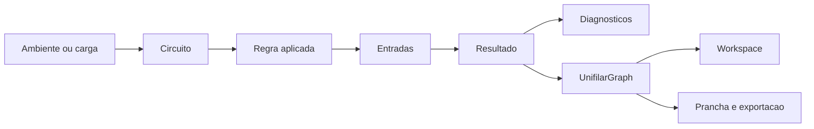
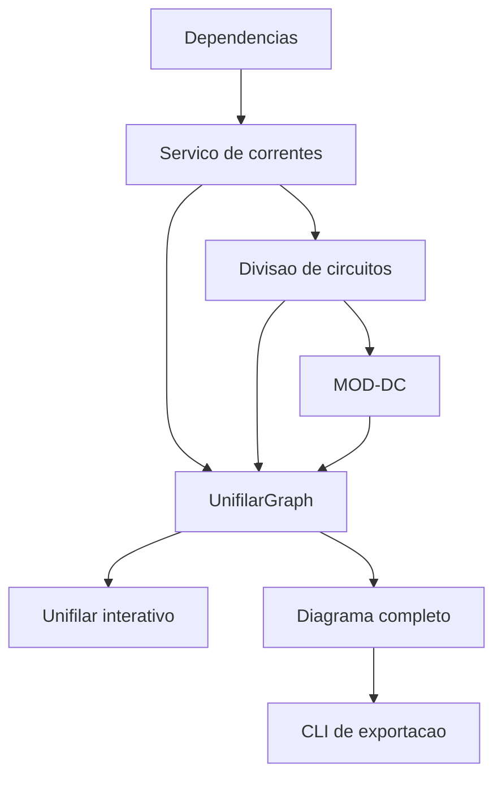

# Análise Competitiva: Seções Unifilar do SIE

> **Status:** Análise consolidada
> **Data-base:** 2026-07-30
> **Escopo:** "Unifilar interativo" e "Diagrama unifilar completo"
> **Responsável:** @analyst (Atlas)
> **Natureza:** Benchmarking e recomendações; não autoriza implementação sem PRD, arquitetura e stories

## 1. Escopo e metodologia

### 1.1 Objetivo

Realizar benchmarking funcional, técnico e visual para:

- diferenciar claramente as duas seções;
- identificar lacunas de conteúdo, navegação e representação gráfica;
- elevar o padrão técnico dos diagramas sem alterar cálculos elétricos;
- definir recomendações para hierarquias, fluxos, tabelas, símbologia, memorial e documentação;
- preservar o `UnifilarGraph` como fonte canonica, sem inferir valores ausentes.

Nesta análise, "organogramas" será interpretado como diagramas hierárquicos e
topológicos da instalacao, e não como elementos decorativos.

### 1.2 Fronteira funcional

| Seção | Papel recomendado |
|---|---|
| **Unifilar interativo** | Workspace operacional para explorar topologia, filtrar, localizar problemas e inspecionar circuitos. |
| **Diagrama unifilar completo** | Prancha técnica normalizada para conferência, impressão, arquivo, revisão e exportacao. |

Essa separação já está declarada no PRD, mas ainda não está suficientemente
evidente na experiencia visual. O codigo atual tambem mantem a barra de
exportacao no workspace interativo, embora o PRD a atribua a seção completa.

### 1.3 Eixos de avaliacao

| Eixo operacional | Eixo documental |
|---|---|
| Explorar e diagnosticar | Conferir e entregar |
| Zoom, pan, filtros e busca | Folha, carimbo e revisão |
| Inspector e rastreabilidade | Legenda, notas e quadro de cargas |
| Camadas e agrupamentos | Hierarquia gráfica deterministica |
| Estados dinamicos | Snapshot técnico auditavel |

Cada referência será avaliada nos dois eixos, evitando tratar uma prancha
técnica como um workspace ou transformar o workspace em uma folha estatica.

### 1.4 Referências propostas

| Categoria | Referência | Razao |
|---|---|---|
| Concorrente direto | **AltoQi Builder Elétrico** | Une hierarquia do quadro, dimensionamento, informações configuráveis e diagrama atualizado com o projeto. |
| Adjacente BIM | **Autodesk Revit MEP** | Referência em templates de quadros, tabelas de circuitos, resumos de cargas e composição em folhas. |
| Aspiracional interativo | **ETAP** | Referência em diagramas inteligentes, hierarquia multinível, datablocks, alinhamento automático e visualização de resultados. |
| Aspiracional documental | **EPLAN Electric P8** | Referência em representação unifilar, paginas técnicas, estruturas de rede e sincronização entre representações. |
| Substituto aberto | **QElectroTech** | Referência acessivel para biblioteca de símbolos, fólios e documentação esquematica. |

### 1.5 Critérios de comparação

1. Clareza da topologia e hierarquia elétrica.
2. Densidade e organização das informações por circuito.
3. Símbologia, linhas, identificadores e nomenclatura.
4. Navegação, zoom, seleção, filtros e rastreabilidade.
5. Estados de erro, atencao, pendencia e conformidade.
6. Quadros de cargas, resumos e datablocks.
7. Pranchas, legenda, carimbo, revisão e exportacao.
8. Escalabilidade para projetos com muitos circuitos.
9. Padronizacao entre tela, SVG, PDF e DXF.
10. Acessibilidade e legibilidade técnica.
11. Sucesso da tarefa para engenheiro, projetista e técnico de execução.
12. Coerência entre a experiencia visual e a arquitetura do produto.

### 1.6 Perspectivas dos stakeholders

- **Engenheiro eletricista:** validação de topologia, fases, proteções,
  condutores, seções, grandezas, status e referências normativas.
- **Projetista:** documentação entregavel, identificadores, legenda, quadro de
  cargas, notas, carimbo, revisão, paginação e exportacao vetorial.
- **Técnico de execução:** localização inequívoca de circuito, origem, destino,
  proteção e condutores em tela e impressão.
- **UX designer:** divulgacao progressiva das informações, legibilidade e
  diferenciação visual entre os dois contextos.
- **Desenvolvimento:** fonte de dados, símbologia e regras de layout
  compartilhadas, com composicoes adequadas a cada finalidade.

### 1.7 Base normativa visual

A avaliacao considerara:

- IEC 60617 para símbolos graficos eletrotécnicos;
- IEC 61082-1 para apresentação de documentos usados em eletrotecnologia;
- ISO 7200 para campos de carimbo e cabeçalho de documentos técnicos.

### 1.8 Entregaveis da análise

1. Matriz de responsabilidades entre as duas seções.
2. Arquitetura de informação recomendada para cada tela.
3. Blueprint visual com topologia, datablocks, tabelas técnicas, legenda e carimbo.
4. Matriz comparativa dos concorrentes e referências aspiracionais.
5. Recomendações priorizadas por impacto, esforço e dependencia.

### 1.9 Fontes e limitações

Fontes:

- artefatos locais do SIE: PRDs, stories, relatorios e codigo-fonte;
- documentação oficial dos produtos comparados;
- paginas oficiais da IEC e ISO para o enquadramento documental.

Limitacoes:

- comparação baseada em documentação oficial pública, sem teste pratico das
  licencas comerciais;
- participacao de mercado, receita e precos não seráo estimados sem dados
  verificaveis;
- recomendações técnicas não substituem validação de engenharia ou análise
  normativa integral;
- a análise não autoriza alteracoes no cálculo, no MOD-DC ou no contrato canônico.

### 1.10 Referências iniciais

- [AltoQi Builder - diagramas unifilar e multifilar](https://suporte.altoqi.com.br/hc/pt-br/articles/115001610573)
- [Autodesk Revit - Panel Schedules](https://help.autodesk.com/cloudhelp/2026/ENU/Revit-DocumentPresent/files/GUID-3D2D0E77-ED17-4FBF-AAE4-CB9185A3F779.htm)
- [ETAP - Intelligent Electrical One-Line Diagram](https://etap.com/product/intelligent-electrical-one-line-diagram)
- [EPLAN - Single-line Representation](https://www.eplan.help/en-us/Infoportal/Content/Plattform/2026/Content/htm/singlepole_k_start.htm)
- [QElectroTech - User Manual](https://download.qelectrotech.org/qet/manual_0.7/build/_downloads/408498051918f1618a071fe56e737db5/QElectroTechdoc-0.8.pdf)
- [IEC 61082-1:2014](https://webstore.iec.ch/en/publication/4469)
- [ISO 7200:2004](https://www.iso.org/standard/35446.html)

---

## 2. Resumo executivo

### 2.1 Diagnóstico central

O SIE já possui a maior parte da fundacao necessaria para combinar inteligencia
operacional e documentação profissional:

- contrato canônico `UnifilarGraph` versionado;
- identificadores estaveis por circuito;
- origem, regra, formula, entradas e referência normativa;
- diagnósticos, pendencias e estados explicitos;
- projeção read-only dos condutores do MOD-DC;
- motor de layout puro e deterministico;
- serializacao do snapshot JSON;
- pipeline CLI para SVG, PDF e DXF;
- carimbo e opcoes de papel, escala e layout;
- fronteira TanStack -> CLI sem acesso do Python ao Supabase.

O problema principal não e ausencia de dados. E a forma como esses dados chegam
as duas experiencias:

1. O **Unifilar interativo** concentra exploracao, filtros, diagnósticos,
   memorial e, atualmente, controles de exportacao.
2. O **Diagrama unifilar completo** reutiliza uma representação linear legada,
   sem materializar integralmente a disciplina documental prevista no PRD.
3. A conversão para `CircuitoCanonico` perde parte do conteúdo já presente no
   `UnifilarGraph`, incluindo a projeção estruturada de condutores.
4. As duas telas usam composição visual semelhante e compartilham o mesmo
   inspector, reduzindo a percepcao de finalidades distintas.

### 2.2 Tese de transformacao

> O SIE deve manter uma unica fonte semantica de dados e criar duas projecoes
> especializadas: uma para investigar o projeto e outra para documenta-lo.

Isso significa:

- **fonte unica**, mas não componente unico;
- **mesmos circuitos, valores, status e origens**, mas layouts diferentes;
- **estado operacional separado do estado documental**;
- **edicao técnica sempre no modulo proprietario**, nunca no desenho;
- **artefatos documentais derivados do mesmo snapshot exibido na tela**.

### 2.3 Resultado esperado

| Contexto | Resultado esperado |
|---|---|
| Unifilar interativo | Workspace técnico para localizar, comparar, diagnosticar e rastrear circuitos. |
| Diagrama unifilar completo | Prancha técnica deterministica para conferência, revisão, impressão, arquivo e exportacao. |
| Contrato canônico | Unica fonte para UI, memorial, JSON, SVG, PDF e DXF. |
| Rastreabilidade | Qualquer símbolo ou valor conduz ao circuito, origem, regra, entradas e owner. |
| Padronizacao | Símbologia, nomenclatura, status e perfis de informação coerentes em todos os formatos. |

### 2.4 Recomendações de maior impacto

| Ordem | Recomendação | Impacto |
|---:|---|---|
| 1 | Fazer a seção completa consumir `UnifilarGraph` sem a projeção legada com perda de dados. | Preserva condutores, origem, status e rastreio. |
| 2 | Retirar a responsabilidade documental do workspace interativo e coloca-la na rota completa. | Torna a fronteira entre explorar e entregar visivel. |
| 3 | Criar um `PranchaModel` derivado, sem copiar ou recalcular fatos elétricos. | Permite folha, carimbo, legenda, tabelas e multipaginas. |
| 4 | Adotar datablocks configuráveis por perfil de leitura. | Aumenta densidade técnica sem poluir o desenho. |
| 5 | Preservar `exportRef` nos elementos e no manifesto de exportacao. | Liga tela, snapshot e artefatos. |
| 6 | Reconciliar o catalogo de símbolos React/Python. | Evita divergência entre navegador e documento. |
| 7 | Diferenciar visualmente o workspace da prancha. | Reduz ambiguidade e melhora a expectativa de uso. |

---

## 3. Estado atual do SIE

### 3.1 Legenda dos achados

- **EVIDENCIA:** comportamento encontrado em codigo, PRD, story ou ADR.
- **INFERENCIA:** conclusão analítica derivada das evidências.
- **PROPOSTA:** recomendação que ainda depende de decisão de produto,
  arquitetura, story e validação.

### 3.2 Unifilar interativo

**EVIDENCIA.** A rota `/projetos/:projetoId/unifilar` funciona como workspace
operacional e oferece:

- indicadores de IB maximo, potencia por fase e desequilibrio;
- busca por circuito ou dependencia;
- filtros de severidade, fases, origem e prontidao;
- modos de layout linear e agrupado;
- agrupamento por dependencia, tipo, fase ou grupo EDP;
- zoom, pan, ajuste a tela e minimapa;
- seleção acessivel por mouse e teclado;
- inspector com resumo, formula, origem, diagnósticos e comparação de controle;
- download do JSON canônico;
- controles de exportacao condicionados ao pipeline Python.

O workspace e construido diretamente sobre `UnifilarGraph`, consulta pura,
motor de layout deterministico e memorial indexado por circuito.

### 3.3 Diagrama unifilar completo

**EVIDENCIA.** A rota `/projetos/:projetoId/unifilar-diagrama` oferece:

- sequencia Rede EDP -> medidor -> quadro -> barramento;
- derivação por circuito;
- DR condicional;
- disjuntor e símbolo de carga;
- rotulo com nome, VA, tensão e IB;
- selo de ATENCAO ou ERRO;
- clique ou teclado para abrir o inspector;
- legenda estatica de símbolos.

O componente `UnifilarDiagramaSecao` monta o mesmo grafo, mas envia para
`UnifilarHero` uma lista convertida para o shape legado `CircuitoCanonico`.

### 3.4 Comparação do estado atual

| Dimensão | Interativo | Completo |
|---|---|---|
| Papel declarado | Workspace operacional | Documento técnico |
| Modelo consumido visualmente | `UnifilarGraph` | `CircuitoCanonico` derivado |
| Layout | Linear ou agrupado | Linear fixo |
| Busca e filtros | Sim | Não |
| Zoom e pan | Sim | Não |
| Inspector | Completo | Mesmo inspector |
| Condutores MOD-DC | Disponiveis no contrato | Não materializados integralmente no Hero |
| Perfil de campos | Fixo no node/inspector | Rotulo fixo |
| Folha e margens | Não aplicável | Não materializadas na visualização web |
| Carimbo e revisão | Não deveriam ser responsabilidade da rota | Previstos no pipeline, pouco visíveis na tela |
| Exportacao | Atualmente presente | Deveria ser o contexto principal segundo o PRD |
| Legenda | Incorporada a experiencia | Estatica abaixo do diagrama |
| Percepcao visual | Card escuro de workspace | Card escuro semelhante |

### 3.5 Findings estruturais

#### F-01 - Fronteira conceitual forte, diferenciação visual fraca

**EVIDENCIA.** PRD e glossario distinguem explicitamente workspace operacional
e documentação técnica.

**INFERENCIA.** Como as duas seções usam cabeçalhos, superficies, cores e
inspector semelhantes, o usuario pode interpreta-las como duas versões do
mesmo diagrama, não como duas etapas complementares.

#### F-02 - Exportacao esta associada ao contexto incorreto

**EVIDENCIA.** O PRD determina que configuração e exportacao profissional
pertencam a `/unifilar-diagrama`. O codigo atual ainda renderiza
`UnifilarExportBar` no workspace interativo.

**INFERENCIA.** A localização atual reforca a confusão de papéis e reduz a
disciplina documental da seção completa.

#### F-03 - A seção completa usa uma projeção com perda de dados

**EVIDENCIA.** `paraCircuitoCanonico()` define `disjuntor_a` e `secao_mm2` como
`null`, enquanto `UnifilarGraph` 1.1 já suporta `condutores` com owner,
material, isolacao, fase, neutro, PE, PEN, status, critério e rastreio.

**INFERENCIA.** A tela completa não consegue ser mais completa do que o shape
legado que recebe, ainda que o contrato já tenha informações superiores.

#### F-04 - O desenho técnico ainda não e uma prancha

**EVIDENCIA.** A pagina web exibe o diagrama em um card responsivo e uma legenda
separada.

**INFERENCIA.** Faltam sinais documentais na propria visualização: folha,
margens, zonas, titulo, identificacao do projeto, revisão, quadro de circuitos,
notas e composição previsivel para impressão.

#### F-05 - O mesmo inspector atende tarefas diferentes

**EVIDENCIA.** As duas seções reutilizam `UnifilarInspector`.

**INFERENCIA.** O reaproveitamento de dados e positivo, mas o painel completo de
diagnóstico pode competir com a leitura da prancha. Na seção documental, o
clique deveria priorizar localização, referências cruzadas e ficha técnica do
elemento, sem transformar a folha em outro workspace.

#### F-06 - A base de rastreabilidade e um diferencial real

**EVIDENCIA.** O contrato inclui `dependenciaId`, `origem`, `rastreio`,
`diagnosticos`, `pendencias`, owner MOD-DC e `exportRef`.

**INFERENCIA.** O SIE pode superar ferramentas orientadas apenas a desenho se
transformar esses campos em navegação e evidência documental.

---

## 4. Panorama competitivo

### 4.1 Estrutura funcional

O conjunto competitivo e fragmentado por objetivo:

| Segmento | Referências | Centro de valor |
|---|---|---|
| Projeto elétrico predial brasileiro | AltoQi Builder | Dimensionamento, detalhamento, quadros e entrega no contexto nacional |
| BIM predial | Autodesk Revit MEP | Coordenacao, parametros, tabelas e folhas |
| Sistemas elétricos de potencia | ETAP | Modelo inteligente, análise e operação sobre o unifilar |
| ECAD industrial | EPLAN | Documentação padronizada e sincronização entre representações |
| Desenho elétrico assistido | QElectroTech | Construcao de esquemas, fólios e biblioteca de símbolos |

**INFERENCIA.** Nenhuma referência pública analisada combina exatamente:

- contexto NBR 5410 e EDP;
- rastreio de origem e formula;
- workspace web;
- contrato versionado comum;
- exportacao vetorial derivada do mesmo snapshot.

Essa combinacao representa o espaço de diferenciação do SIE.

### 4.2 Priorização qualitativa

Não foram encontrados dados públicos suficientes para estimar participacao de
mercado de forma defensavel. A priorização usa:

- sobreposicao com o trabalho realizado pelo SIE;
- pressão de benchmark sobre qualidade visual e técnica;
- transferibilidade dos padroes para a arquitetura atual.

| Prioridade | Referência | Sobreposicao | Pressão de benchmark | Papel na análise |
|---|---|---:|---:|---|
| P1 | AltoQi Builder | Alta | Alta | Concorrente funcional direto |
| P2 | ETAP | Média | Alta | Referência para inteligencia operacional |
| P2 | Autodesk Revit MEP | Média | Alta | Referência para tabelas e folhas |
| P3 | EPLAN | Baixa/média | Média/alta | Referência para disciplina documental |
| P4 | QElectroTech | Média | Baixa/média | Referência aberta de desenho e símbolos |

### 4.3 Mapa de posicionamento

Eixos:

- horizontal: disciplina documental;
- vertical: inteligencia operacional.

| Posicao qualitativa | Solucoes |
|---|---|
| Alta inteligencia + alta disciplina documental | ETAP, EPLAN em seus dominios |
| Alta inteligencia + disciplina documental em evolucao | SIE atual |
| Inteligencia predial + forte entrega documental | AltoQi Builder |
| Coordenacao parametrica + forte composição documental | Revit MEP |
| Desenho manual + documentação basica | QElectroTech |

**PROPOSTA.** O posicionamento-alvo do SIE e ocupar alta inteligencia e alta
disciplina documental no nicho de instala??es elétricas de baixa tensão
orientadas ao contexto brasileiro.

---

## 5. Perfis dos concorrentes e referências

### 5.1 AltoQi Builder Elétrico - Prioridade 1

#### Evidências públicas

A documentação oficial descreve o diagrama unifilar editavel como representação
simultanea da planilha de dimensionamento e da visualização hierarquica do
quadro. O diagrama e atualizado quando o projeto muda. A ferramenta permite:

- ordenacao dos circuitos conforme o gerenciador do quadro;
- agrupamento logico de circuitos protegidos por IDR;
- informações adicionais configuráveis;
- biblioteca de símbolos;
- personalizacao da exibição de textos;
- alteracao de componentes por meio das propriedades do quadro;
- integração do detalhe com pranchas.

#### Pontos fortes

- Proximidade com o fluxo de projeto predial brasileiro.
- Relacao clara entre quadro, dimensionamento e desenho.
- Atualizacao do diagrama a partir do modelo.
- Personalizacao documental.
- Visão hierarquica orientada ao quadro.

#### Pontos de atencao

- Experiencia fortemente associada a ambiente CAD/desktop.
- Personalizacao pode aumentar variabilidade entre documentos.
- Edicao visual não deve incentivar divergência entre desenho e cálculo.

#### Aprendizado aplicável ao SIE

1. Ordenacao e hierarquia devem refletir a estrutura do quadro.
2. Campos do datablock devem ser configuráveis por perfil.
3. Componentes são alterados na origem e o diagrama se atualiza.
4. Documento e planilha técnica devem ser complementares.

#### O que não copiar

- Edicao livre de fatos elétricos diretamente na prancha.
- Complexidade CAD sem beneficio para o usuario web.
- Dependencia de ajustes manuais para obter consistencia.

### 5.2 ETAP - Prioridade 2

#### Evidências públicas

O ETAP apresenta o one-line diagram como interface inteligente para modelar,
validar, visualizar, analisar, monitorar e gerenciar sistemas elétricos. Entre
os recursos documentados:

- Auto-Build com espacamento e alinhamento por regras;
- DataBlocks configuráveis;
- redes compostas e sub-redes aninhadas;
- símbolos multicoloridos;
- integração entre sistemas AC, DC e aterramento;
- formatação automática de unidades e precisão;
- exibição ou ocultacao conforme zoom, equipamento, estado e resultado;
- temas e coloração orientados aos resultados.

#### Pontos fortes

- Diagrama como interface do modelo, não como imagem final.
- Divulgacao progressiva de informação.
- Hierarquia multinível.
- Datablocks reutilizaveis.
- Regras de layout e precisão.

#### Pontos de atencao

- Escopo de potencia e simulacao muito superior ao dominio atual do SIE.
- Densidade e configurabilidade podem aumentar curva de aprendizagem.
- Cores de resultado precisam de alternativa textual para acessibilidade.

#### Aprendizado aplicável ao SIE

1. Datablocks por perfil de tarefa.
2. Informacao visivel conforme nivel de zoom.
3. Sub-redes para quadros e grupos.
4. Layout automático como função deterministica.
5. Resultado técnico junto do elemento, não apenas em painel separado.

#### O que não copiar

- Escopo industrial não requerido pelos artefatos do SIE.
- Simulacoes ou estados elétricos inexistentes no contrato.
- Complexidade visual permanente.

### 5.3 Autodesk Revit MEP - Prioridade 2

#### Evidências públicas

A documentação do Revit estrutura panel schedules em quatro partes:

1. cabeçalho;
2. tabela de circuitos;
3. resumo de cargas;
4. rodape.

Os schedules podem ser agrupados, ordenados e filtrados por parametros do
painel, sistema de distribuição, nivel, numero de fases e parametros de projeto.
Templates controlam formato, largura, bordas, slots, colunas e resumo.

#### Pontos fortes

- Estrutura documental previsivel.
- Templates compartilhados.
- Integração entre parametros e folhas.
- Tabela de circuitos e resumo como parte do documento.
- Atualizacao de instancias associadas ao template.

#### Pontos de atencao

- O BIM completo e desnecessario para o escopo atual do SIE.
- Uma tabela não substitui a topologia elétrica.
- Excesso de parametrizacao pode esconder a tarefa principal.

#### Aprendizado aplicável ao SIE

1. Organizar a prancha em zonas funcionais.
2. Tratar quadro de circuitos e resumo de cargas como componentes de primeira
   classe.
3. Usar templates documentais versionados.
4. Permitir agrupamento e ordenacao sem alterar o dado elétrico.

#### O que não copiar

- Dependencia de um modelo BIM para tarefas que o SIE já resolve pelo contrato.
- Interface de authoring generica.

### 5.4 EPLAN Electric P8 - Prioridade 3

#### Evidências públicas

A documentação do EPLAN afirma que a representação unifilar simplifica
componentes e conexoes, permite visoes gerais de planta e estruturas de rede,
oferece símbolos de conexão agrupada e sincroniza funções entre diferentes
tipos de representação. Relatorios multifilares podem ser derivados mesmo
quando o projeto usa representação unifilar.

#### Pontos fortes

- Disciplina de paginas e tipos de documento.
- Referências cruzadas.
- Sincronização entre representações.
- Estruturas de rede e modulos padronizados.
- Separação entre função e forma de representação.

#### Pontos de atencao

- Dominio industrial e de maquinas difere do foco predial do SIE.
- Sistema de designacao e paginas pode ser excessivo para projetos menores.

#### Aprendizado aplicável ao SIE

1. Uma função elétrica pode ter varias representações sem duplicar o dado.
2. A referência cruzada deve ser parte do documento.
3. Paginas e seções devem ter tipos explicitos.
4. O símbolo representa uma função identificada, não um desenho isolado.

#### O que não copiar

- Estruturas industriais sem requisito.
- Taxonomia documental mais complexa do que o projeto exige.

### 5.5 QElectroTech - Prioridade 4

#### Evidências públicas

O manual oficial apresenta suporte a diagramas unifilares, multifilares,
controle, fólios e colecoes de elementos. A proposta e centrada na composição
de esquemas elétricos por elementos e condutores.

#### Pontos fortes

- Amplitude de símbolos.
- Modelo de fólios.
- Baixa barreira de acesso.
- Referência util para convencoes de edicao e bibliotecas.

#### Pontos de atencao

- Predominio de fluxo manual de desenho.
- Menor evidência pública de rastreio semantico e cálculo integrado.
- Risco de o documento se tornar fonte paralela ao modelo.

#### Aprendizado aplicável ao SIE

1. Biblioteca de símbolos deve ser navegavel e documentada.
2. Fólios e referências entre folhas importam para diagramas extensos.
3. O editor deve manter regras claras de conexão.

#### O que não copiar

- Transformar o SIE em editor elétrico generico.
- Permitir desenho desconectado do contrato canônico.

---

## 6. Matriz comparativa

Escala qualitativa:

- **Forte:** capacidade central e públicamente documentada.
- **Parcial:** capacidade existente, limitada ou não central.
- **Não evidênciado:** não confirmado nas fontes analisadas.
- **Diferencial SIE:** capacidade especifica encontrada nos artefatos locais.

| Capacidade | SIE atual | AltoQi | ETAP | Revit MEP | EPLAN | QElectroTech |
|---|---|---|---|---|---|---|
| Topologia unifilar | Forte | Forte | Forte | Parcial | Forte | Forte |
| Hierarquia de quadros/sub-redes | Parcial | Forte | Forte | Parcial | Forte | Parcial |
| Layout automático deterministico | Forte | Forte | Forte | Parcial | Parcial | Não evidênciado |
| Busca e filtros operacionais | Forte | Parcial | Forte | Forte em schedules | Forte em navegadores | Parcial |
| Datablocks configuráveis | Parcial | Forte | Forte | Forte em tabelas | Forte | Parcial |
| Inspector com origem e formula | Diferencial SIE | Não evidênciado | Parcial por dados/resultados | Parcial por parametros | Parcial | Não evidênciado |
| Referência normativa por regra | Diferencial SIE | Parcial | Parcial | Não evidênciado | Parcial | Não evidênciado |
| Estados VERIFICAR/NÃO_APLICÁVEL | Forte no contrato | Não evidênciado | Parcial | Parcial | Parcial | Não evidênciado |
| Condutores com owner MOD-DC | Forte no contrato | Forte no dominio | Forte em outro dominio | Parcial | Forte | Parcial |
| Tabela de circuitos/cargas | Parcial na experiencia | Forte | Forte por resultados | Forte | Forte por relatorios | Parcial |
| Folha, cabeçalho e rodape | Forte no pipeline, fraco na tela | Forte | Forte | Forte | Forte | Forte |
| Carimbo e revisão | Disponivel no pipeline | Forte | Forte | Forte | Forte | Parcial |
| JSON canônico versionado | Forte | Não evidênciado | Modelo proprio | Modelo proprio | Modelo proprio | Formato proprio |
| SVG/PDF/DXF do mesmo snapshot | Forte na arquitetura | Parcial | Forte em formatos proprios | Forte em folhas | Forte | Parcial |
| Experiencia web | Forte | Não central | Parcial/cloud | Não central | Não central | Não central |
| Contexto NBR 5410/EDP | Diferencial SIE | Forte no Brasil | Não central | Não central | Não central | Não central |

### 6.1 Conclusão da matriz

O SIE não precisa vencer pela amplitude das ferramentas maduras. Sua vantagem
potencial e a integridade do fluxo:

```text
requisito e dependencia
    -> calculo
    -> contrato rastreavel
    -> investigacao no workspace
    -> snapshot
    -> documento tecnico
```

Ferramentas concorrentes demonstram padroes importantes, mas a combinacao de
rastreio de regra, origem fisica, estado explicito e exportacao por contrato e
particularmente valiosa para o SIE.

---

## 7. Análise estrategica

### 7.1 SWOT do SIE

#### Forcas

- Contrato canônico versionado.
- Separação entre dominio de cálculo e visualização.
- Rastreio por regra, formula, entradas e referência.
- Owner explicito para condutores MOD-DC.
- Estados ausentes sem inferencia silenciosa.
- Layout puro e testavel.
- Experiencia web com busca, filtros, zoom e teclado.
- Pipeline CLI desacoplado do banco.
- Exportacao baseada no snapshot.

#### Fraquezas

- Diferenciação visual insuficiente entre as duas seções.
- Seção completa dependente de shape legado.
- Informacao técnica concentrada no inspector.
- Ausencia de datablocks configuráveis no desenho.
- Prancha não materializada integralmente na interface.
- Símbologia duplicada entre React e Python.
- Exportacao associada ao contexto interativo.
- Hierarquia atual limitada essencialmente ao barramento e circuitos.

#### Oportunidades

- Posicionar o SIE como workspace auditavel para baixa tensão.
- Criar perfis de leitura para projetista, revisor e execução.
- Ligar cada item da prancha ao memorial e a origem.
- Reduzir retrabalho manual em CAD.
- Gerar pacote documental coerente: JSON, SVG, PDF, DXF e manifesto.
- Explorar revisões e comparação entre snapshots.
- Transformar diagnósticos em indice de pendencias da prancha.

#### Ameacas

- Crescimento de escopo para simulacao industrial.
- Tentativa de reproduzir um CAD generico.
- Divergência visual e semantica entre React e Python.
- Excesso de informação reduzindo legibilidade.
- Afirmacoes normativas sem validação integral.
- Edicao na prancha criando segunda fonte de verdade.
- Performance degradada em projetos extensos.

### 7.2 Oportunidade de espaço proprio

**PROPOSTA.** O SIE pode se diferenciar como:

> Ambiente web de engenharia para investigar e documentar instala??es
> elétricas de baixa tensão com rastreabilidade do requisito ao artefato.

Esse posicionamento evita competir diretamente com:

- autoria BIM completa;
- simulacao de sistemas de potencia;
- ECAD industrial;
- desenho CAD generico.

---

## 8. Principio construtivo: uma fonte, duas projecoes

### 8.1 Arquitetura conceitual

```text
MODULOS PROPRIETARIOS
Correntes | Divisor | MOD-DC | Dependencias
                  |
                  v
        montarUnifilarGraph()
                  |
                  v
       UnifilarGraph 1.1 imutavel
 topologia | valores | origem | rastreio
 diagnosticos | condutores | exportRef
          /                         \
         /                           \ snapshot JSON
        v                             v
PROJECAO OPERACIONAL          PROJECAO DOCUMENTAL
Unifilar interativo           Diagrama completo
busca e filtros               papel e margens
zoom e selecao                carimbo e revisao
agrupamentos                  legenda e notas
inspector                     tabelas e datablocks
estado dinamico               SVG/PDF/DXF
```

### 8.2 Tres tipos de estado

| Tipo | Exemplos | Autoridade |
|---|---|---|
| Técnico canônico | IB, tensão, fases, condutores, status, origem, regra | Modulos de dominio -> `UnifilarGraph` |
| Operacional | busca, filtros, zoom, seleção, grupos colapsados | Estado do workspace |
| Documental | papel, escala, layout, carimbo, revisão, perfil de campos | `DocumentProfile`/opcoes de exportacao |

Regras:

1. Estado operacional não altera o contrato.
2. Estado documental não recalcula fatos elétricos.
3. Alteracao técnica retorna ao modulo owner.
4. O grafo e regenerado apos mudanca valida.
5. Todas as representações leem a nova versão.

### 8.3 Invariantes

1. Mesmo `node.id` em tela, JSON e artefatos.
2. Mesmo `exportRef` em todas as representações.
3. `null` permanece `null`.
4. `VERIFICAR` nunca recebe valor visual presumido.
5. A UI não calcula seção, proteção, demanda ou corrente.
6. O renderer não acessa Supabase.
7. Mesmo grafo + mesmo perfil = mesma composição logica.
8. Filtro e zoom não alteram o documento oficial, salvo escolha documental
   explicita e registrada.

### 8.4 Correção do bridge legado

Estado atual:

```text
UnifilarGraph
  -> paraCircuitoCanonico()
     -> disjuntor_a: null
     -> secao_mm2: null
     -> UnifilarHero
```

Estado-alvo:

```text
UnifilarGraph
  -> projetarPrancha(graph, documentProfile)
     -> PranchaModel
        -> preview React
        -> snapshot JSON
        -> CLI SVG/PDF/DXF
```

`CircuitoCanonico` pode permanecer temporariamente para compatibilidade, mas não
deve limitar a experiencia documental.

---

## 9. Modelo documental proposto

### 9.1 PranchaModel

**PROPOSTA sujeita a @architect.** `PranchaModel` e um read model de composição,
não um novo dominio elétrico.

```text
PranchaModel
|-- meta
|   |-- projetoId
|   |-- graphVersion
|   |-- documentProfileId
|   |-- revisao
|   `-- geradoEm
|-- folhas[]
|   |-- papel, orientacao e margens
|   |-- zonas
|   |-- diagramas[]
|   |-- tabelas[]
|   |-- notas[]
|   |-- legenda
|   `-- carimbo
`-- referencias[]
    |-- exportRef
    |-- folha
    |-- coordenada
    `-- tipoRepresentacao
```

O modelo pode conter posicoes, quebras de folha e estilos, mas qualquer valor
elétrico deve referênciar o node de origem.

### 9.2 DocumentProfile

Perfis sugeridos:

| Perfil | Uso | Campos principais |
|---|---|---|
| Compacto | Visão geral | circuito, descrição, fase, potencia, status |
| Engenharia | Conferência | tensão, IB, proteção, condutores, critério |
| Execução | Campo | origem/destino, proteção, fase, N, PE/PEN, eletroduto |
| Auditoria | Revisão | regra, referência, fonte, status e exportRef |

Perfis controlam visibilidade e formatação. Eles não criam campos ausentes.

### 9.3 DataBlock por circuito

Exemplo conceitual:

```text
+--------------------------------------------------+
| C07 | TUG COZINHA                     ATENCAO     |
| R+S | 220 V | 2200 VA | IB 10,00 A               |
| DJ [VERIFICAR] | F 2,5 | N 2,5 | PE 2,5 mm2      |
| Origem: Cozinha | Regra: ... | Ref: U:1.1:C07    |
+--------------------------------------------------+
```

Camadas:

- linha 1: identidade e severidade;
- linha 2: grandezas elétricas;
- linha 3: proteção e condutores;
- linha 4: origem e rastreabilidade.

No workspace, o DataBlock pode variar conforme zoom. Na prancha, o perfil e
fixado no momento da geracao.

### 9.4 Manifesto documental

**PROPOSTA.** Cada pacote exportado deve possuir manifesto legível por maquina:

```text
projetoId
graphVersion
documentProfile
opcoes de papel/escala/layout
formatos gerados
diagnosticos
circuitos e exportRefs
revisao
data
```

Hash do snapshot e hash dos artefatos são opcoes de hardening a serem avaliadas
por arquitetura; não são requisitos atuais confirmados.

---

## 10. Rastreabilidade ponta a ponta

### 10.1 Cadeia esperada

```text
Simbolo ou DataBlock
      |
      v
exportRef
      |
      v
UnifilarNode
      |
      +--> dependenciaId --> ambiente/carga de origem
      |
      +--> rastreio --> regra --> referencia normativa
      |                  |
      |                  +--> formula e entradas
      |
      +--> condutores --> owner MOD-DC
      |
      +--> diagnosticos e pendencias
```

### 10.2 Interação no workspace

Ao selecionar um circuito:

1. destacar node, arestas e grupo;
2. manter diagnósticos obrigatórios visíveis;
3. mostrar DataBlock completo;
4. abrir rastreio em etapas:
   `origem -> regra -> entradas -> resultado`;
5. oferecer navegação ao modulo owner quando houver acao autorizada;
6. nunca permitir editar o valor calculado diretamente no SVG.

### 10.3 Evidência na prancha

Na prancha:

- cada circuito recebe identificador estavel;
- referências cruzadas indicam folha/zona quando houver quebra;
- legenda explica estados e convencoes;
- tabela lista diagnósticos e pendencias;
- manifesto relaciona `exportRef` com folha e posicao;
- o preview pode permitir clique para abrir memorial, sem alterar o documento.

### 10.4 Rastreio nos formatos

| Formato | Estrategia |
|---|---|
| JSON | Campos completos do contrato e manifesto |
| SVG | `id` ou `data-export-ref` nos grupos de circuito |
| PDF | Indice/tabela de referências e links quando suportados |
| DXF | Layers, handles ou atributos conforme capacidade validada |

As técnicas especificas de PDF/DXF precisam de avaliacao do @architect e do
@dev antes de virar critério de aceite.

---

## 11. Transformacao do Unifilar interativo

### 11.1 Missão

> Responder rapidamente: onde esta o circuito, qual seu estado, por que possui
> esse resultado e qual modulo e responsável pela correção?

### 11.2 Arquitetura de informação

```text
+-----------------------------------------------------------------------+
| Projeto > Eletrica > [Explorar] [Documentar]       Snapshot / status  |
+-----------------------------------------------------------------------+
| KPIs tecnicos: IB max | fases | desequilibrio | erros | pendencias    |
+-----------------------------------------------------------------------+
| Busca | filtros | agrupamento | camadas | ajustar vista               |
+--------------------+--------------------------------+-----------------+
| Navegador          | Canvas tecnico                 | Inspector       |
| - Quadros          | topologia e DataBlocks         | Resumo          |
| - Dependencias     | zoom/pan/minimapa              | Rastreio        |
| - Fases            | selecao e foco                 | Diagnosticos    |
| - Pendencias       |                                | Origem/owner    |
+--------------------+--------------------------------+-----------------+
```

**PROPOSTA.** As abas "Explorar" e "Documentar" podem manter as rotas atuais,
servindo apenas como navegação contextual e sinal de finalidade.

### 11.3 Diagramas adequados ao workspace

| Diagrama | Pergunta respondida | Fonte |
|---|---|---|
| Arvore elétrica | Como quadros e circuitos se relacionam? | nodes e edges |
| Mapa de dependencias | Qual ambiente/carga originou o circuito? | `origem` |
| Fluxo de rastreio | Como o valor foi derivado? | `rastreio` |
| Distribuição por fases | Como as cargas estão distribuidas? | fases e resumo |
| Mapa de diagnósticos | Onde estão erros e atenções? | diagnósticos |

Não se recomenda usar fluxogramas genericos quando a topologia elétrica ou uma
tabela técnica responder melhor.

### 11.4 Hierarquia visual

Nivel 1 - sempre visivel:

- quadro/barramento;
- identificador e nome;
- fase;
- severidade;
- continuidade topologica.

Nivel 2 - zoom intermédiario:

- tensão;
- potencia;
- IB;
- proteção;
- status de dimensionamento.

Nivel 3 - seleção ou zoom alto:

- condutores;
- metodo;
- origem;
- critério decisivo;
- referências e pendencias.

### 11.5 Interacoes prioritarias

- Busca com foco e realce.
- Filtros compostos com contador vivo.
- Agrupamento por quadro/dependencia/tipo/fase.
- Colapso de sub-redes.
- Breadcrumb técnico ao entrar em um grupo.
- Seleção sincronizada entre arvore, canvas e inspector.
- Atalho para voltar a visão geral.
- Copia da referência técnica do circuito.
- Comparação entre estado automático e manual quando o contrato fornecer dados.

### 11.6 Mudancas recomendadas

| Atual | Recomendado |
|---|---|
| Cards de circuito com informação fixa | DataBlocks por zoom e perfil |
| Inspector unico e extenso | Resumo persistente + abas focadas |
| Exportacao no workspace | Link para a area Documentar |
| Agrupamento visual em bandas | Hierarquia de quadros/sub-redes quando o contrato suportar |
| Cores de severidade | Cor + icone + texto/codigo |
| Metricas em tiles equivalentes | Faixa compacta priorizada por risco |

### 11.7 O que evitar

- Simular edicao CAD.
- Permitir arrasto que altere ordem elétrica sem comando de dominio.
- Exibir todos os campos em todos os niveis de zoom.
- Usar cor como unica indicacao.
- Ocultar diagnósticos obrigatórios por causa de filtros.
- Transformar o workspace em preview permanente de papel.

---

## 12. Transformacao do Diagrama unifilar completo

### 12.1 Missão

> Responder: este documento representa integralmente o snapshot aprovado e
> possui informação suficiente para conferência, execução, revisão e arquivo?

### 12.2 Experiencia-alvo

A primeira area da rota deve ser um preview real de folha, não um card de
dashboard. Controles documentais ficam em uma barra discreta acima ou ao lado.

```text
+-----------------------------------------------------------------------+
| Projeto > Eletrica > [Explorar] [Documentar]   Revisao | Gerar        |
+----------------------+------------------------------------------------+
| Configuracao         | PREVIEW DA FOLHA                              |
| Papel/orientacao     | +------------------------------------------+  |
| Perfil de campos     | | Titulo / identificacao                   |  |
| Layout               | |------------------------------------------|  |
| Escala               | | Diagrama hierarquico                     |  |
| Carimbo              | | + DataBlocks                             |  |
| Revisao/data         | |                                          |  |
| Formatos             | |------------------------------------------|  |
| Diagnosticos         | | Quadro de circuitos | legenda | notas    |  |
|                      | |------------------------------------------|  |
|                      | | Carimbo / revisao / folha                |  |
|                      | +------------------------------------------+  |
+----------------------+------------------------------------------------+
```

### 12.3 Anatomia recomendada da prancha

1. Identificacao da folha e titulo.
2. Diagrama unifilar hierárquico.
3. DataBlocks dos circuitos.
4. Quadro de circuitos/cargas.
5. Resumo de fases e cargas.
6. Legenda de símbolos e estados.
7. Notas e referências normativas aplicadas.
8. Lista de pendencias quando existente.
9. Carimbo com projeto, responsável, escala, revisão, data e folha.

### 12.4 Hierarquia elétrica do desenho

```text
Concessionaria / entrada
  -> medicao
    -> protecao geral
      -> quadro principal
        -> barramentos R/S/T/N/PE
          -> dispositivo de protecao do circuito
            -> DR/DPS quando aplicavel e confirmado
              -> condutores
                -> carga ou quadro subordinado
```

Somente elementos existentes no contrato podem ser materializados. Elementos
ausentes devem aparecer como `VERIFICAR` ou ser omitidos conforme regra
documentada, nunca presumidos.

### 12.5 Quadro de circuitos

Campos candidatos, condicionados a disponibilidade:

| Grupo | Campos |
|---|---|
| Identidade | circuito, descrição, origem, grupo |
| Elétrico | fases, tensão, potencia, IB |
| Proteção | requisito DR, dispositivo, corrente nominal quando disponivel |
| Condutores | material, isolacao, fase, neutro, PE/PEN |
| Instalacao | metodo de referência, eletroduto |
| Decisão | critério decisivo, status de dimensionamento |
| Rastreio | regra, referência, owner, exportRef |

O perfil documental define quais colunas aparecem em cada entrega.

### 12.6 Legenda profissional

A legenda deve:

- mostrar o símbolo na mesma proporção usada no documento;
- apresentar nome técnico e codigo interno;
- indicar a referência do catalogo validado;
- explicar tracejádo, estados e referências cruzadas;
- incluir apenas símbolos usados na folha, com opcao de catalogo completo;
- ser gerada pela mesma fonte de símbolos do renderer.

### 12.7 Carimbo e revisão

O pipeline atual já suporta projeto, responsável técnico, papel, escala, revisão
e data. A visualização deve tornar esses campos parte do preview.

Campos e comprimentos devem ser validados segundo o padrão documental adotado.
A ISO 7200 e referência para campos de cabeçalho e carimbo, mas não substitui
requisitos locais e profissionais.

### 12.8 Estrategia multipagina

**PROPOSTA.** Para projetos extensos:

1. folha de visão geral;
2. uma folha por quadro ou sub-rede;
3. quadro de circuitos nas folhas correspondentes;
4. referências cruzadas entre alimentador e destino;
5. indice de folhas e revisões.

Quebras devem ser deterministicas. O mesmo snapshot e perfil devem produzir a
mesma divisão logica.

### 12.9 Interação permitida no preview

- zoom e pan do papel;
- selecionar circuito para realcar referências;
- abrir ficha técnica em painel auxiliar;
- alternar perfil antes da geracao;
- validar pendencias;
- gerar formatos dispon?veis.

Não deve ser permitido:

- mover símbolos de forma que altere semantica;
- editar valores calculados;
- ocultar erro bloqueante sem registro;
- alterar o snapshot durante uma revisão sem gerar nova versão.

---

## 13. Sistema visual e padronizacao

### 13.1 Principio

O workspace pode usar uma interface operacional escura, desde que legível. A
prancha deve simular o meio final de entrega: superficie clara, margens
definidas, linhas técnicas e uso restrito de cor.

### 13.2 Diferenciação visual

| Elemento | Interativo | Completo |
|---|---|---|
| Superficie | Workspace operacional | Folha técnica |
| Fundo | Tema da aplicação | Branco ou equivalente de impressão |
| Cor | Estados e seleção | Excecao, revisão e diagnóstico |
| Tipografia | Interface e leitura dinamica | Documento e identificacao técnica |
| Controles | Busca, filtro, zoom | Papel, perfil, revisão e exportacao |
| Densidade | Progressiva | Deterministica |
| Layout | Adaptavel | Proporção de folha |

### 13.3 Tokens semanticos

Definir tokens por função, não por cor arbitraria:

- `diagram-line-primary`;
- `diagram-line-secondary`;
- `diagram-line-pending`;
- `diagram-text-primary`;
- `diagram-text-muted`;
- `diagram-status-info`;
- `diagram-status-warning`;
- `diagram-status-error`;
- `diagram-selection`;
- `sheet-border`;
- `sheet-grid`;
- `sheet-title-block`.

Mapeamentos de espessura para tela e impressão devem ser validados em testes de
renderizacao, evitando assumir equivalencia direta entre pixels e milimetros.

### 13.4 Tipografia

- Manter familia legível e já adotada pelo produto.
- Usar numeros tabulares para grandezas.
- Diferenciar identificador, descrição e valor.
- Evitar texto menor do que o validado para impressão no papel escolhido.
- Manter unidades junto ao valor.
- Preservar zeros e precisão conforme regra de formatação, não por preferência
  visual do componente.

### 13.5 Símbolos

- Uma identidade por símbolo.
- Geometria baseada em grid e proporcoes comuns.
- Mesma semantica no React e Python.
- Catalogo versionado.
- Estado pendente não modifica o significado do símbolo; modifica estilo e
  anotacao.
- Símbolos novos exigem validação técnica e documental.

### 13.6 Rotulo padrão de circuito

Ordem sugerida:

```text
ID | descricao | fase(s) | tensao
potencia | IB | protecao
F/N/PE/PEN | metodo | status
```

O perfil pode reduzir campos, mas deve preservar identidade e estado.

### 13.7 Estados

| Estado | Representação |
|---|---|
| Confirmado | Linha continua + valor |
| Verificar | Linha/contorno diferenciado + texto `VERIFICAR` |
| Não aplicável | Ausencia controlada ou `N/A`, conforme perfil |
| Atencao | Icone + codigo + texto, alem da cor |
| Erro | Icone + codigo + texto, alem da cor |
| Provisorio | Marca persistente no cabeçalho e no circuito quando relevante |

---

## 14. Diagramas, fluxos e organização profissional

### 14.1 Quando usar cada representação

| Necessidade | Representação recomendada |
|---|---|
| Estrutura elétrica | Diagrama unifilar hierárquico |
| Relacao quadro-circuito | Arvore ou rede composta |
| Origem do circuito | Mapa de dependencia |
| Derivação de um valor | Fluxo de rastreio |
| Cargas por fase | Barras comparativas ou tabela |
| Conformidade | Lista priorizada e fluxo de decisão |
| Sequencia de revisão/exportacao | Fluxograma de processo |
| Responsabilidade entre modulos | Diagrama de ownership |

### 14.2 Fluxo de rastreio



### 14.3 Ownership construtivo



Esses diagramas explicam relacoes. Eles não substituem o unifilar elétrico
principal.

---

## 15. Catalogo unico de símbolos

### 15.1 Problema

O PRD registra duplicação entre componentes React e implementação Python.
Mesmo quando os nomes coincidem, duas geometrias independentes podem divergir
em proporção, ponto de conexão, legenda e cobertura.

### 15.2 Direcao recomendada

**PROPOSTA sujeita a arquitetura.**

Criar um registro versionado com:

- id do símbolo;
- nome;
- categoria;
- pontos de conexão;
- viewBox/grid;
- estados suportados;
- referência documental;
- variantes permitidas;
- codigo da legenda.

React e Python podem manter renderizadores proprios, mas devem consumir os
mesmos metadados e fixtures de conformidade.

### 15.3 Testes de reconciliacao

- Todos os ids do contrato possuem símbolo ou fallback explicito.
- React e Python reconhecem a mesma versão do catalogo.
- Legenda usa os símbolos efetivamente renderizados.
- Fixtures comparam dimensoes, ancoras e identificadores.
- Símbolo desconhecido gera diagnóstico, não desaparece silenciosamente.

---

## 16. Integração com a estrutura existente

### 16.1 Componentes preservados

| Componente/camada | Papel futuro |
|---|---|
| `UnifilarGraph` | Fonte canonica |
| `montarUnifilarGraph` | Projeção dos modulos proprietarios |
| `serializarUnifilarGraph` | Snapshot para UI/CLI |
| `layout-unifilar.ts` | Base do layout operacional |
| `UnifilarCanvas` | Canvas do workspace |
| `UnifilarInspector` | Base de rastreio, com composição orientada ao contexto |
| `UnifilarExportBar` | Controles documentais na rota completa |
| API TanStack | Orquestracao segura do CLI |
| CLI Python | Validação e renderizacao profissional |

### 16.2 Componentes candidatos

Os nomes abaixo são conceituais e não constituem decisão de arquitetura:

| Candidato | Responsabilidade |
|---|---|
| `DocumentProfile` | Campos e configuração documental |
| `PranchaModel` | Composição pura das folhas |
| `UnifilarSheetPreview` | Preview React do modelo documental |
| `CircuitDataBlock` | Informacao técnica por circuito |
| `CircuitSchedule` | Quadro de circuitos/cargas |
| `TraceabilityManifest` | Referências entre snapshot e artefatos |
| `SymbolRegistry` | Metadados comuns de símbologia |

### 16.3 Fronteiras

- `domain/` não importa componentes.
- Pipeline Python não acessa banco.
- UI não deriva regra normativa.
- Renderer não altera snapshot.
- Perfil documental não e armazenado como fato elétrico.
- Alteracoes de dominio ocorrem apenas por comandos dos modulos owners.

---

## 17. Roteiro de evolucao

Qualquer implementação deve iniciar por PRD/épico/story conforme a Constitution.

### Fase 0 - Decisoes e contratos

Objetivo:

- confirmar escopo;
- aprovar modelo de projeção documental;
- validar fronteiras de ownership;
- definir fonte da símbologia.

Responsaveis sugeridos:

- @pm/@po: escopo e priorização;
- @architect: contratos e boundaries;
- @ux-design-expert: arquitetura da informação e preview;
- @sm: stories.

### Fase 1 - Correção estrutural

Entregas:

- seção completa consumindo `UnifilarGraph`;
- remocao da dependencia funcional do shape legado;
- exportacao no contexto documental;
- invariantes de dados entre rotas;
- nenhuma regressão no workspace.

Prioridade: **P0**.

### Fase 2 - Diferenciação das experiencias

Entregas:

- navegação Explorar/Documentar;
- workspace sem controles documentais;
- preview de folha na rota completa;
- DataBlock compacto no workspace;
- painel documental focado em folha e referências.

Prioridade: **P0/P1**.

### Fase 3 - Prancha profissional

Entregas:

- `DocumentProfile`;
- `PranchaModel`;
- quadro de circuitos;
- resumo de cargas/fases;
- legenda contextual;
- carimbo no preview;
- diagnósticos documentais.

Prioridade: **P1**.

### Fase 4 - Rastreabilidade de artefatos

Entregas:

- `exportRef` preservado no SVG;
- manifesto de exportacao;
- referências de folha/zona;
- consistencia JSON/SVG/PDF/DXF;
- relatorio de campos ausentes.

Prioridade: **P1**.

### Fase 5 - Escala e refinamento

Entregas:

- sub-redes e quadros subordinados quando suportados pelo contrato;
- multipaginas;
- perfis de execução e auditoria;
- comparação entre revisões, se aprovada;
- validação com usuarios.

Prioridade: **P2**.

### 17.1 Matriz impacto x esforço

| Iniciativa | Impacto | Esforço estimado qualitativo |
|---|---:|---:|
| Consumir grafo diretamente na seção completa | Muito alto | Medio |
| Mover exportacao para Documentar | Alto | Baixo/medio |
| Diferenciar visualmente as rotas | Alto | Medio |
| DataBlocks por perfil | Alto | Medio |
| Preview de folha | Alto | Medio/alto |
| Quadro de circuitos | Alto | Medio |
| Registro unico de símbolos | Muito alto | Alto |
| Manifesto de rastreabilidade | Alto | Medio |
| Multipaginas | Medio/alto | Alto |
| Comparação de revisões | Medio | Alto |

Estimativas precisam ser refinadas pelo @architect e @dev apos stories.

---

## 18. Critérios de qualidade propostos

Estes critérios devem ser convertidos em acceptance criteria por @po/@sm antes
de implementação.

### 18.1 Integridade de dados

- Todos os circuitos do snapshot aparecem ou possuem justificativa de exclusão.
- Identificadores e `exportRef` permanecem estaveis.
- Nenhum valor `null` e substituido por default visual.
- Condutores exibidos correspondem ao owner MOD-DC.
- A UI não recalcula resultados.
- O manifesto e os artefatos referênciam a versão do grafo.

### 18.2 Determinismo

- Mesmo grafo e perfil produzem mesma ordem, agrupamento e quebra logica.
- Filtros do workspace não alteram o documento oficial.
- Datas vari?veis são controladas por opcao explicita.
- Snapshots de teste cobrem layouts representativos.

### 18.3 Legibilidade

- Textos não colidem com símbolos.
- Rotulos longos possuem estrategia de quebra ou abreviacao documentada.
- Estados possuem texto e icone, não apenas cor.
- Preview continua legível nos papéis suportados.
- Projetos extensos não comprimem indefinidamente a tipografia.

### 18.4 Rastreabilidade

- Selecionar um circuito localiza sua origem.
- Valor técnico conduz a regra e entradas quando dispon?veis.
- Artefato conduz ao mesmo `exportRef`.
- Diagnósticos obrigatórios não podem ser ocultados silenciosamente.
- Campos ausentes geram relatorio claro.

### 18.5 Acessibilidade

- Operação por teclado.
- Foco visivel.
- `aria-label` com identidade e estado.
- Ordem de tabulacao coerente com a topologia.
- Contraste validado.
- Conteúdo equivalente para indicacoes cromaticas.

### 18.6 Qualidade de engenharia

- lint, typecheck, testes e build verdes;
- testes do CLI Python verdes;
- fixtures de React/Python reconciliadas;
- cobertura dos estados vazio, parcial, verificar, atencao e erro;
- checklist e File List da story atualizados.

---

## 19. Cenarios de validação com usuarios

### Engenheiro eletricista

1. Localizar o circuito com maior IB.
2. Confirmar fases, tensão, proteção e condutores.
3. Identificar a regra e as entradas do cálculo.
4. Conferir se a prancha representa o mesmo snapshot.

### Projetista

1. Selecionar perfil de entrega.
2. Configurar papel, escala, revisão e carimbo.
3. Conferir quebras e quadro de circuitos.
4. Gerar PDF/DXF sem ajuste manual de valores.

### Técnico de execução

1. Encontrar circuito por ambiente/carga.
2. Identificar fase, proteção e condutores.
3. Entender símbolos pela legenda.
4. Seguir referência para outra folha ou quadro.

### Revisor/QA

1. Filtrar erros e pendencias.
2. Comparar node, memorial e documento.
3. Verificar campos `VERIFICAR`.
4. Auditar `exportRef`, revisão e manifesto.

Metricas de tempo e sucesso devem ser medidas primeiro como baseline; este
relatorio não estabelece metas numericas sem observacao de usuarios.

---

## 20. Riscos e mitigacoes

| Risco | Efeito | Mitigacao |
|---|---|---|
| Duplicar modelo no `PranchaModel` | Divergência de valores | Guardar referências; fatos permanecem no grafo |
| React e Python divergem | Tela diferente do artefato | Registro comum, fixtures e testes cruzados |
| Excesso de campos | Diagrama ilegível | Perfis e divulgacao progressiva |
| Edicao direta na prancha | Segunda fonte de verdade | Acoes retornam ao modulo owner |
| Uso excessivo de cor | Falha de acessibilidade/impressão | Icone, texto, padrão e contraste |
| Projetos grandes | Compressão ou lentidao | Sub-redes, virtualizacao e multipaginas |
| Quebra não deterministica | Revisões inconsistentes | Algoritmo puro e snapshots |
| Norma citada incorretamente | Risco técnico | Validação especializada e rastreio da fonte |
| Escopo industrial | Perda de foco | Limites explicitos do PRD |
| Documento com dados pendentes | Entrega inadequada | Gate e lista de pendencias |

---

## 21. Recomendações estrategicas finais

1. **Tratar o UnifilarGraph como produto interno.** Versão, validação e
   compatibilidade devem receber o mesmo rigor de uma API.
2. **Diferenciar por tarefa.** Explorar e Documentar devem parecer etapas
   complementares, não telas duplicadas.
3. **Eliminar a projeção documental com perda.** A seção completa deve acessar
   toda a semantica do contrato 1.1.
4. **Transformar rastreio em interface.** Origem, regra, owner e exportRef devem
   ser navegaveis.
5. **Usar datablocks configuráveis.** Eles conciliam densidade técnica e
   legibilidade.
6. **Materializar a folha no navegador.** O usuario precisa conferir o que será
   entregue antes de exportar.
7. **Padronizar símbolos e perfis.** React, Python, legenda e documentos devem
   compartilhar identidade e fixtures.
8. **Manter CLI como autoridade de exportacao.** A UI configura e observa; o
   pipeline valida e gera.
9. **Não inventar informação ausente.** `VERIFICAR` e parte da qualidade do
   produto, não uma falha estetica.
10. **Validar com tarefas reais.** O sucesso deve ser medido por conferência,
    diagnóstico, rastreio e entrega, não apenas por aparencia.

---

## 22. Plano de monitoramento competitivo

### Referências a acompanhar

| Prioridade | Fonte | O que observar |
|---|---|---|
| Alta | AltoQi Builder | Evolucao de diagramas, quadros, campos e pranchas |
| Alta | ETAP | DataBlocks, hierarquia, filtros por zoom e visualização de resultados |
| Média | Revit MEP | Templates de schedules, folhas e parametros |
| Média | EPLAN | Sincronização entre representações e referências cruzadas |
| Baixa/média | QElectroTech | Símbolos, fólios e convencoes abertas |

### Cadência

- Mensal: atualizacoes de produto relevantes.
- Trimestral: revisar matriz de capacidades.
- Por épico unifilar: verificar se novos requisitos alteram a fronteira entre
  Interativo e Completo.
- Por revisão normativa: revalidar referências e catalogo de símbolos.

---

## 23. Fontes

### 23.1 Artefatos locais do SIE

- `sistema-de-instala-es-el-tricas-sie-main/docs/prd/diagrama-unifilar-completo-prd.md`
- `sistema-de-instala-es-el-tricas-sie-main/docs/prd/reestruturacao-camada-unifilar-prd.md`
- `sistema-de-instala-es-el-tricas-sie-main/docs/stories/story-11.1-secao-diagrama-unifilar-completo.md`
- `sistema-de-instala-es-el-tricas-sie-main/docs/reports/analise-modulo-unifilar-interativo-2026-07-09.md`
- `sistema-de-instala-es-el-tricas-sie-main/docs/architecture/exportacao-unifilar-contratos-rotas-boundaries.md`
- `sistema-de-instala-es-el-tricas-sie-main/src/domain/unifilar/unifilar-graph.ts`
- `sistema-de-instala-es-el-tricas-sie-main/src/domain/unifilar/layout-unifilar.ts`
- `sistema-de-instala-es-el-tricas-sie-main/src/components/unifilar/unifilar-adapter.ts`
- `sistema-de-instala-es-el-tricas-sie-main/src/components/unifilar/UnifilarWorkspace.tsx`
- `sistema-de-instala-es-el-tricas-sie-main/src/components/unifilar/UnifilarDiagramaSecao.tsx`
- `sistema-de-instala-es-el-tricas-sie-main/src/components/unifilar/UnifilarHero.tsx`
- `sistema-de-instala-es-el-tricas-sie-main/src/components/unifilar/UnifilarInspector.tsx`
- `sistema-de-instala-es-el-tricas-sie-main/src/components/unifilar/UnifilarLegenda.tsx`

### 23.2 Fontes externas oficiais

- [AltoQi - Como gerar e personalizar os diagramas Unifilar editavel e Multifilar](https://suporte.altoqi.com.br/hc/pt-br/articles/115001610573)
- [AltoQi Builder - Software para projetos elétricos em BIM](https://website.altoqi.com.br/builder/software-para-projetos-elétricos-em-bim)
- [ETAP - Intelligent Electrical One-Line Diagram](https://etap.com/product/intelligent-electrical-one-line-diagram)
- [Autodesk Revit - Panel Schedules](https://help.autodesk.com/cloudhelp/2026/ENU/Revit-DocumentPresent/files/GUID-3D2D0E77-ED17-4FBF-AAE4-CB9185A3F779.htm)
- [Autodesk Revit - Customize Panel Schedule Templates](https://help.autodesk.com/cloudhelp/2024/ENU/Revit-GetStarted/files/GUID-583B892A-09C3-443A-A4F5-10CD808571A4.htm)
- [EPLAN - Single-line Representation](https://www.eplan.help/en-us/Infoportal/Content/Plattform/2026/Content/htm/singlepole_k_start.htm)
- [QElectroTech - User Manual](https://download.qelectrotech.org/qet/manual_0.7/build/_downloads/408498051918f1618a071fe56e737db5/QElectroTechdoc-0.8.pdf)
- [IEC 61082-1:2014](https://webstore.iec.ch/en/publication/4469)
- [ISO 7200:2004](https://www.iso.org/standard/35446.html)
- [ISO 7083:2021](https://www.iso.org/standard/66740.html)

---

## 24. Encaminhamento recomendado

Este relatorio deve ser entregue:

1. ao @pm/@po para converter as recomendações aprovadas em escopo;
2. ao @architect para validar `PranchaModel`, `DocumentProfile`, registro de
   símbolos e manifestos;
3. ao @ux-design-expert para wireframes e especificacao visual;
4. ao @sm para criar stories com acceptance criteria;
5. ao @dev e @qa somente depois da story estar Ready.

Nenhuma proposta deste documento deve ser implementada como requisito implicito.
