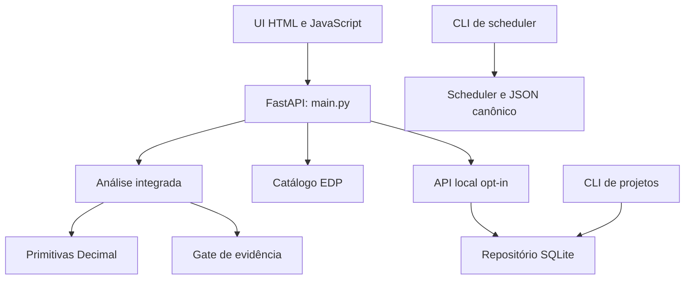

# Mapa de dependências — F00

Baseline `8d86db26f5e8675eaced4638af14bd84019e15e7`. Tarefa 00.02/00.07. Mapa derivado dos imports, contratos e consumidores observados; decisão de migração em `ESTRATEGIA_MIGRACAO.md`. Resultados de instalação/testes ficam em `BASELINE_CI.md`.

## Runtime de produto identificado

| Origem e referência | Dependência | Contrato e direção | Limite observado |
|---|---|---|---|
| `apps/web/app.js:1-23` | `main.py` | GET saúde; POST análise; JSON de resultados | Base configurável via sie.apiBase; tabela embutida na UI |
| `apps/web/app.js:28,50-118` | `storage_api.py` | PUT projeto e GET por UUID com Bearer | URL fixa loopback; não é configuração compartilhada com sie.apiBase |
| `main.py:6-17,81-99` | `application.py`, `domain/edp.py`, `storage_api.router` | Validação Pydantic e chamadas síncronas | Não importa otimizador TS ou pacote Unifilar |
| `application.py:3-25` | `domain/engines.py`, `domain/gates.py` | Dicionário → dataclasses/Decimal → saída JSON | A ordem condutor→disjuntor preserva ENG-001; fonte do cliente não aprova norma |
| `domain/models.py:4-19` | `Decimal`/dataclass | Entidade CircuitoEletrico isolada | Não é o modelo Pydantic `Circuito` de main.py |
| `storage_api.py:10,23-60` | `storage.py` | Token/env habilitam repositório e operações | Sem usuário/organização de produção |
| `cli.py:17,59-85` | `storage.py` | Arquivo JSON/UUID/revisão ↔ SQLite | CLI sem servidor/token; mesmo formato de armazenamento |
| `storage.py:5-10,17-103` | stdlib sqlite3/json/UUID/datetime | DDL local; transação; revisão otimista; histórico de ações | Histórico não é snapshot; não sincroniza Supabase |
| `scheduler_cli.py:9-12,33-69` | `scheduler.py` | inspect/queue/promote/transition | Operação de estado, sem execução de agentes |
| `scheduler.py:185-220` | JSON local/stdlb filesystem | load/validate/save com expected_revision | replace atômico, sem lock interprocesso; um gravador por workspace |
| `normative_inventory.py:14-63` | seis documentos locais | bytes → SHA256/presença/metadados | Não usa tabelas para cálculo e não valida norma/OCR |

Todos os caminhos de API nessa tabela têm prefixo `restructuring/apps/api/sie_api/`; os caminhos de UI têm prefixo `restructuring/`. Manual dos contratos: `restructuring/docs/MANUAL-OPERACIONAL.md`, `PERSISTENCIA-LOCAL.md`, `CONTRATOS-ENGENHARIA.md`; escalonador: `docs/sie-orchestrator/SCHEDULER-GUIDE.md`.

## Dependências instaláveis e fronteiras de qualidade

| Fronteira | Declaração | Verificação prevista/observada |
|---|---|---|
| API Python | `pyproject.toml:1-14`: Python>=3.11, setuptools>=68, wheel; FastAPI>=0.110,<1; Pydantic>=2,<3; uvicorn>=0.27,<1 | pip install e pytest nos logs de baseline; intervalos não fixam ambiente reproduzível sem snapshot de versões |
| Testes Python | pytest>=8,<10; httpx>=0.27,<1 | Diretório `apps/api/tests`; testes HTTP por TestClient |
| Navegador | playwright>=1.55,<2; Chromium separado | `restructuring/e2e/test_browser_flow.py`; workflow raiz instala navegador |
| UI estática | HTML/CSS/JS e APIs fetch/crypto; sem bundler | node --check e teste de contrato HTML; E2E separado |
| Root AIOX | `package.json:6-10` chama script Node | “typecheck” verifica sintaxe e exports JS do tooling; não compila TypeScript |
| Runtime AIOX | `.aiox-core/package.json` e lockfile próprios | CI `npm ci --prefix .aiox-core --ignore-scripts`; separado do produto |

Workflows ativos estão em `.github/workflows/`: `sie-restructuring-api.yml:21-35` instala/testa API, verifica JS e gera inventário de seis fontes; `sie-e2e-browser.yml:24-32` instala Playwright/Chromium e roda E2E; `sie-orchestrator-quality.yml:32-41` instala AIOX e roda quatro gates raiz. O YAML em `restructuring/.github/workflows/api-quality.yml` não é workflow ativo da raiz. CI remoto é conferido em `BASELINE_CI.md`; documentação antiga não prova nova execução.

## Dependências ausentes ou não integradas

| LEGACY-ID | Relação encontrada | Estado | Consequência/ação reversível |
|---|---|---|---|
| 021 | `otimizador.ts:6-20` importa `../modelo/tipos` e `./validadores` | Ausentes na árvore src da baseline | Reter arquivo; recuperar fonte completa antes de executar/portar C1-C6 |
| 021–022 | Teste usa Vitest; schema usa Zod | Nenhum runner/dependência TS no package raiz | npm test verde não valida esses arquivos; não instalar/montar validadores fictícios |
| 023 | Schema normativo SQL → seed Tabela36 | Aplicação Postgres não verificada; SQL tem COMMENT inline e constraint expressão a testar | Preservar SQL original; corrigir e caracterizar somente em banco descartável futuro |
| 024 | Retornos downstream → FK `public.dependencias` | Tabela-base ausente do conjunto de cinco migrations | Não presumir cadeia de migrações completa |
| 025–026 | Overrides/config QT → FK `public.projetos` | Tabela-base ausente; repos TS mencionados nos comentários não presentes | Não confundir com SQLite `projetos` local; não aplicar em produção |
| 027 | Unifilar router → loader `carregar_pontos` | Loader inicialmente None; registro exigido; não montado em main.py | Pacote histórico responde 503 sem injeção se montado; não é tela atual |
| 027 | React/TSX/SVG e design tokens → UI | A UI atual não importa esses componentes; sem build React atual | Reter pacotes 5/6/7; integração exige story/contrato próprios |
| 028 | Exportador DXF → ezdxf | Biblioteca não declarada no pyproject atual | Arquivo exemplo não comprova exportação operacional atual |
| 029–030,032–037 | Plano legado → funções e relatórios citados | Implementação integrada não localizada | Lacunas formais por comportamento; preservar documentação, recuperar original antes de portar |

## Dados e fontes externas

Não há cliente OpenAI, Supabase, Hostinger ou chamada de serviço pago no runtime Python lido. O teste TS de Tabela36 tem cliente Supabase e requer `VITE_SUPABASE_URL`/`VITE_SUPABASE_ANON_KEY`; sua execução conectaria recurso externo e não integra a suite Python/SDC. Nenhuma credencial foi necessária para inventariar os arquivos. Não se inferiu banco, usuário ou política remotos a partir do SQL.

`NOR-01`, `NOR-02`, `EDP-01` e `SEC-01` existentes continuam sujeitos às condições registradas no estado canônico e nos pareceres; fonte presente/hash não libera conteúdo, catálogo não libera padrão e token local não libera produção.

## Dependências de migração

F00 caracteriza e retém → contrato/código original recuperado ou lacuna formal aceita → fonte/dados técnicos conferidos → adapter isolado e testes de equivalência → decisão de troca controlada → validação e rollback em cópia local → eventual produção em fase autorizada. Preservação de fonte nesta fase não aciona as etapas posteriores. O fluxo técnico é proposto, sujeito ao parecer do @architect e aos três QA.
