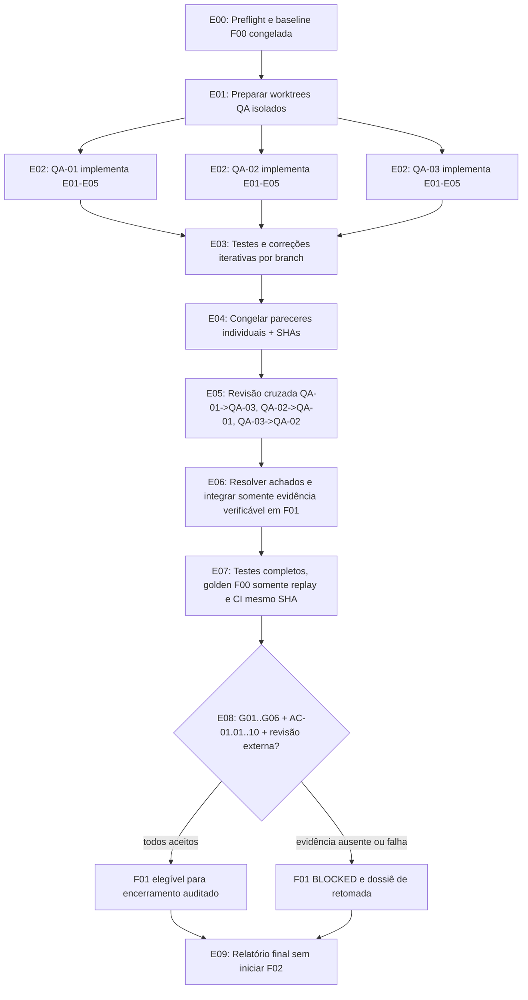

# SIE 2.0 — PLANO MESTRE DE EXECUÇÃO AUTÔNOMA YOLO — F01
**Versão:** 1.0 | **Data:** 2026-10-15 | **Escopo:** somente F01 | **Base verificada:** `feat/f01-governanca-normativa` = `4c1ed308f743105cd43ba3d66b84a115c2632b23`

> **Ativação:** ao receber este arquivo, o coordenador deve executar automaticamente o fluxo E00→E09 na F01, em regime fail-closed. Nenhuma autorização repetitiva é exigida para alterações no **ambiente isolado** e nas branches QA/F01. O executor CLI precisa estar instalado e autenticado previamente. Este documento é instrução de execução, **não evidência de que a execução já ocorreu**.

## I. Missão e limites indeclináveis
Retomar a F01 **sem reabrir F00**; executar QA-01, QA-02 e QA-03 como sessões independentes, em três branches próprias; corrigir fontes, engenharia, aplicação, estrutura, dados e UX; preservar golden F00 e usá-los **exclusivamente para regressão**; executar repetidamente testes técnicos; congelar pareceres independentes antes de permitir revisão cruzada; integrar alterações verificadas apenas na branch F01; executar seis gates G01–G06 e critérios AC-01.01...AC-01.10; somente se todas as evidências forem aceitas permitir a avaliação de conclusão F01. **Nunca iniciar F02 nesta execução**: a transição seguinte é uma decisão de fase distinta, posterior à aprovação formal e verificada da F01.

YOLO = aprovar ferramentas, edição de código local, testes e commits seguros sem perguntas. YOLO **não** significa aceitar alucinações, presumir direitos autorais, alterar `main`, forçar merge, gravar secrets, utilizar produção ou declarar revisão profissional fictícia.

## II. Ponto exato de retomada
- F00: `DONE` na fonte de verdade `docs/sie-orchestrator/ORCHESTRATOR_STATE.json`, baseline golden preservada; não fazer tarefas F00, não alterar os arquivos originais nem reabrir PR #2.
- F01: `BLOCKED`, `feat/f01-governanca-normativa`, draft PR #3: https://github.com/SFPTechnology/Projeto-SIE-2.0/pull/3.
- Três perfis GitHub Copilot: `.github/agents/f01-qa-arquiteto.agent.md`; `f01-qa-engenheiro-eletrico.agent.md`; `f01-qa-dados-ux-llm.agent.md`. Skills especializadas em `.github/skills/f01-*/SKILL.md`.
- Branches QA com mesmo baseline `8aec14ac0817ba75ea5e5cee90240368807f1bf7`: `qa/f01-arquiteto`, `qa/f01-engenheiro-eletrico`, `qa/f01-dados-ux-llm`. Issues: #4, #5, #6.
- `docs/implantacao-sie-2-0/F01/QA3_MANIFEST.json`: G01/G04/G05 PARCIAL, G02/G03/G06 BLOCKED; **0/6 aprovados**. O orquestrador técnico ainda tem **0 células Rca/XL/Iz/EDP homologadas** e **0 casos numéricos normativos independentes aprovados**.
- Snapshots atuais gravam metadados de catálogo SQLite e não as regras/células efetivamente usadas por circuito ou memória histórica integral.

## III. Contrato de execução sem intervenção
**Gatilho único:** `python scripts/f01_yolo_runner.py --execute --sandbox-confirmed` na raiz do repositório, com Git, Python, Node e GitHub Copilot CLI já autenticados em **VM/container descartável, sem credenciais de produção**. Requer autenticação inicial previamente configurada; o sistema **não** coleta senhas. `python scripts/f01_yolo_runner.py` apenas mostra o plano. O executor cria worktrees isolados e usa `copilot --agent=<perfil> -p <tarefa> --yolo --no-ask-user`.

**Escopo das permissões:** só branches `qa/f01-*` e `feat/f01-governanca-normativa`; sem ações automáticas em `main`, F00, deploy, banco remoto, serviços pagos adicionais ou publicação normativa. O isolamento da VM/container e proteção de branches no GitHub são controles **externos** indispensáveis: `--yolo` libera ferramentas, caminhos e URLs e um prompt não oferece sandbox de segurança.

**Autonomia limitada e observável:** três ciclos corretivos por agente, no máximo duas rodadas de integração, timeout por sessão, logs fora do repositório e relatório de tentativas; parar em `BLOCKED_EVIDENCE`, `BLOCKED_SECURITY` ou `FAILED_TECHNICAL` quando não houver ação segura. Não executar loop infinito. Não executar ações normativas irrecuperáveis por suposição.

**Dado de fonte confiável:** normas e concessionárias consultadas por documentos originais licenciados ou autorizados e páginas oficiais verificáveis, jamais por pesos da LLM. Se faltarem fonte/edição/tabela/célula e dupla conferência externa, corrigir a arquitetura e produzir relatório de lacuna `BLOCKED_EVIDENCE` sem inventar número; não marcar PASS.

## IV. Máquina de estados e DAG


**E00 Pré-verificações:** confirmar `git status` limpo, refs, `main` intacta, F00 DONE, F01 BLOCKED, PR #3 draft, inventário, perfis, seis skills, manifesto e verificador. Inspecionar lacunas, riscos e licenças. `main` ou F00 inesperadamente alteradas ⇒ parar e documentar.

**E01 Isolamento:** três `git worktree` em pastas diferentes, cada uma com sua branch e contexto do mesmo SHA inicial. Desativar leitura do andamento das outras trilhas antes de congelamento da primeira revisão. Não usar um único prompt fingindo três revisores.

**E02 Execução integral por cada QA:** *todos os três* fazem etapas técnicas E01-E05 conforme `QA3_MULTIAGENTES_PLANO_EXECUCAO.md`: (1) fontes/aplicabilidade e licenças; (2) tabela/célula, unidades e condições; (3) casos independentes com resultados esperados; (4) rastreabilidade por circuito/regra e UX com memória/histórico; (5) segurança, conflitos, regressão, QA. QA-01 enfatiza código/CI/segurança; QA-02 elétrica BT/NBR 5410/EDP; QA-03 dados/UX/LLM.

**E03 Auto-heal sem enganar:** executar por branch testes unitários/API, replay golden F00 `--verify`, verificador de invariantes, frontend, Chromium onde disponível, segurança, backup/restore. Em falhas, reencaminhar log de erro ao próprio agente e repetir até três tentativas; sem alterar expectativas originais ou desabilitar testes. Fontes sem verificação não são defeitos corrigíveis por repetir prompts: classificar como impedimento externo.

**E04 Parecer inicial congelado:** antes de compartilhar qualquer trabalho, cada QA grava `docs/implantacao-sie-2-0/F01/qa3-runs/QA-XX/{PLANO_E_EXECUCAO.md,MATRIZ_6_GATES.json,PARECER_QA.md}` com commits, evidência, bloqueios, fontes (quando autorizadas) e datas. Congelar SHA inicial imutável; parecer de LLM ≠ aprovação normativa habilitada.

**E05 QA cruzado:** QA-01 audita QA-03; QA-02 audita QA-01; QA-03 audita QA-02; registrar achados com ID, severidade, evidência e correção. Só depois do congelamento permitir ver commits de outra branch. Pelo menos uma revisão externa/documental independente das normas é requisito fora da autonomia auto declaratória.

**E06 Integração:** comparar implementações e pareceres, selecionar solução tecnicamente fundamentada e registrar decisões. Integrar em `feat/f01-governanca-normativa` com commits isolados e rastreáveis, sem mesclar automaticamente três implementações conflitantes. Um integrador LLM pode corrigir conflitos no branch F01, mas não pode homologar norma por voto. Antes de qualquer push, executar testes e verificador; manter PR #3 draft.

**E07 Verificação final:** garantir que cada evidência CI se refira ao MESMO SHA integrado: API/pytest, Chromium/E2E, AIOX, replay F00, inventário/hashes, revisão de segurança/UX, licenças, alterações de norma/regra, rollback e logs; CI recente não herda aprovação de commits anteriores. Verificação local não equivale a GitHub Actions concluído.

**E08 Gate de liberação:** executar `python scripts/f01_release_gate.py --verify-invariants` (só coerência) e `--check-release` (falha enquanto não existirem provas). Conferir 6/6 no manifesto, **10/10 AC** no orquestrador e revisão documental profissional/independente quando aplicável. Não usar `git push` como evidência de gate, nem mudar `BLOCKED` para `DONE` somente com output de IA.

**E09 Entrega:** atualizar `RELATORIO_EXECUCAO.md`, `QA-01.md`, `QA-02.md`, `QA-03.md`, `NEXT_ACTION.md`, manifesto e estado com fatos aferidos; links CI, SHAs e contas reais. Se não houver evidência normativa ou signoff, resultado **BLOCKED_EVIDENCE** com lista exata de células/documentos faltantes e correções já implementadas. O executor não publica produção nem começa F02.

## V. Matriz executável de gates
| Gate | Semântica PASS somente quando... | Falha |
|---|---|---|
| G01 | Fonte primária identificada (edição, licença, vigência, aplicação territorial/tipologia e hash) | Incógnita ≠ verificado |
| G02 | **100% das células necessárias ao escopo efetivamente implementado** Iz/fatores/Rca/XL/EDP transcritas com unidade/linha/coluna/notas e verificadas por duas leituras genuínas | Não substituir Rca/XL por Rdc20 |
| G03 | Casos quantitativos independentes por motor, expected derivado fora do SIE, tolerância e referência técnica | Golden F00 não é homologação |
| G04 | Inputs/outputs/memória/regras consumidas por circuito e revisão persistidos/reproduzíveis; regras não inferidas de catálogo; testes de integridade/rollback | Snapshot só de catálogo não basta |
| G05 | Testes API, F00 replay, Chromium, CI no SHA final, segurança/UX, histórico/backup comprovados | Não apagar testes falhos |
| G06 | Três primeiros pareceres independentes congelados, três revisões cruzadas e divergências resolvidas, com atestação documental externa necessária | Três personas na mesma sessão não bastam |

**Regras técnicas:** não ampliar silenciosamente escopo para excluir células problemáticas; documentar motores/tabelas fora do escopo e bloquear outputs correspondentes. Não usar `verified_data=true` como autodeclaração de homologação. Nenhum `PASS` se faltarem provas de autenticidade/independência.

## VI. Limites de autonomia (sem perguntas repetitivas)
| Ocorrência | Ação automática |
|---|---|
| Teste falha / API 500 / UX inconsistente | Diagnosticar, corrigir, reexecutar testes e registrar diferença |
| Branch QA divergente | Tentar integração controlada em worktree F01, sem force-push; se conflito técnico irredutível, registrar `FAILED_TECHNICAL` |
| Documento primário não acessível ou sem direito de uso | Continuar implementação segura não dependente dele; `BLOCKED_EVIDENCE` para gate específico |
| Interpretação técnica divergente com dados disponíveis | Preservar divergência, registrar fontes e solicitar futura revisão independente; `BLOCKED_EVIDENCE` |
| Autenticação/instalação CLI inexistente | `BLOCKED_ENVIRONMENT`; não solicitar credenciais em chat ou inventar login |
| Testes passam, mas 6 gates não | `F01 BLOCKED`, sem F02 |
| 6 gates verificáveis e AC 10/10 | Preparar dossiê de fechamento; só declarar DONE conforme orquestrador e signoff técnico exigido; nunca iniciar F02 neste plano |

## VII. Política de segurança real do YOLO
- **Obrigações anteriores ao primeiro comando:** VM/container descartável, checkout limpo, proteção GitHub para `main`/F00, conta/tokens de permissão mínima restrita à branch de QA/F01, backup/snapshot, sem `.env`, credenciais Supabase, fontes protegidas sob paths expostos ao agente sem autorização.
- `--yolo` concede acesso amplo a comandos, caminhos e URLs. Só a infraestrutura isolada fornece o confinamento; prompts e scripts Python não oferecem bloqueio de sistema operacional.
- Nunca fazer deploy, executar migração de produção, assinar laudos, extrair norma privada para GitHub, ou reescrever evidências de F00.
- O executor deve parar ao atingir limite de tentativas ou erro não recuperável, gerar logs sem secrets e manter `BLOCKED`. **A ausência de intervenção humana não garante aprovação normativa profissional.**

## VIII. Executável, comandos e critérios de aceite do plano
O executor operacional correspondente é `scripts/f01_yolo_runner.py`. Prévia (não executa agentes):
```powershell
python scripts/f01_yolo_runner.py
```
Execução autônoma **apenas em ambiente isolado** com autenticação Copilot CLI preparada:
```powershell
python scripts/f01_yolo_runner.py --execute --sandbox-confirmed
```
O executor deve trabalhar nas três branches independentes, fazer relatório de QA, testes e revisão cruzada, e parar ao final com `BLOCKED` ou `READY_FOR_EXTERNAL_VERIFICATION` sem abrir F02; **não interpretar código de saída zero dos testes como liberação do gate**.

### Prompt-mestre para o coordenador autônomo
> Atue como Coordenador Autônomo SIE F01 (YOLO) e execute o plano inteiro de E00 a E09. Não reabra a F00 nem mexa em main; execute três custom agents em worktrees/contexts realmente isolados, cada um implemente integralmente as cinco etapas de correção com suas skills. Faça auto-heal de testes em loops finitos, congele cada primeiro parecer, realize QA cruzado, integre apenas melhorias com testes/evidências na branch F01, execute regressões da F00 somente como referência e confronte G01-G06 e AC-01.01..AC-01.10. Não pergunte em ações rotineiras; quando normas ou revisão externa faltarem, registre BLOCKED_EVIDENCE sem inventar conteúdo. Nunca inicie F02. Gere relatório factual completo com commit SHA e evidências.

## IX. Condição definitiva de sucesso
`F01 DONE` só pode ser considerado após **6/6 G**, **10/10 AC**, três QA iniciais e cruzados comprovados, revisão de engenharia/norma externa onde necessária, CI em SHA final, sem blockers críticos. Se qualquer item falhar, **F01 BLOCKED com checkpoint melhorado**, sem reabrir F00 e sem antecipar F02.

## X. Documentos de apoio
- `QA3_MULTIAGENTES_PLANO_EXECUCAO.md` — perfis e skills.
- `QA3_MANIFEST.json` — seis gates atuais.
- `docs/sie-orchestrator/ORCHESTRATOR_STATE.json` — estado canônico.
- `docs/sie-orchestrator/NEXT_ACTION.md` — último blocker e checkpoint.
- `scripts/f01_release_gate.py` — guardião determinístico.
- `.github/workflows/sie-restructuring-api.yml`, `sie-e2e-browser.yml`, `sie-orchestrator-quality.yml` — CI.
