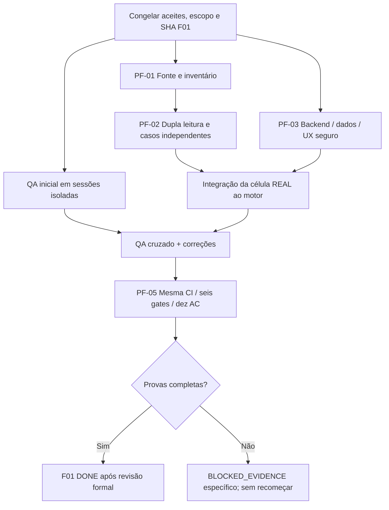

# SIE 2.0 — PLANO ÚNICO E EXECUTÁVEL DE FECHAMENTO DA F01
**Versão 1.0 — 16/10/2026**  
**Fonte de verdade:** `docs/sie-orchestrator/ORCHESTRATOR_STATE.json` + `QA3_MANIFEST.json`  
**Branch de integração:** `feat/f01-governanca-normativa` · **PR #3 em rascunho**  
**F00: DONE, baseline intocável. F01: BLOCKED até provas. F02: não liberada.**

## 0. Decisão executiva: parar de criar planos e começar a remover impedimentos
Este documento **substitui como roteiro operacional prioritário** os planos de tentativa `PLANO_EXECUCAO_AUTONOMA_YOLO.md` e `PLANO_YOLO_DESBLOQUEIO_F01_V2.md` (preservados apenas para histórico). Reutilizar código, manifests, scripts, skills, três branches e GitHub Actions existentes; **não criar novo framework, novo runner, novas fases, ou reabrir F00**.

O impedimento principal não é falta de mais uma rodada de CI. É a cadeia crítica:
**original autorizado + edição/abrangência** → **inventário exaustivo das células necessárias** → **conferência dupla** → **casos esperados normativos independentes** → **vínculo ao dado REAL consumido pelo motor e memória de cálculo** → **QA3 independente** → **6 gates + 10 AC + CI no mesmo SHA + atestação externa**.

**Antes de prometer F01 DONE**, conferir disponibilidade de documento primário autorizado ABNT, direito de uso, dois leitores genuinamente independentes e homologação profissional requerida. Sem um desses itens, nenhum modo YOLO tem como produzir um encerramento legítimo. O executor deve continuar tarefas seguras, congelar bloqueio objetivo e não repetir tentativas infrutíferas. A pessoa usuária **não precisa aprovar cada task de software**.

## 1. Constatações verificadas no repositório — não refazer trabalho pronto
- **EDP PDF local já disponível:** `Arquivos_Diversos/Norma_EDP/PT.DT.PDN.00068_V9.pdf` (~2,68 MB), além de `..._chunks.json`, Markdown derivado e PDFs separados de tabelas 1 e 2. O manifesto F00 registra seu SHA-256 `b14f414001d9831f91bbef84f022c5164f367431cc6a209e5fb34b4e48f20810`. É um **candidato a original**, ainda não comparado ao arquivo publicado pela EDP; uma assinatura SHA de repositório não autentica origem.
- **NBR 5410 está no repositório como texto derivado:** `Arquivos_Diversos/NBR_5410_original/NBR-5410.md` e chunks; existe `Arquivos_Diversos/NBR_5410_comentada/NBR 5410 Comentada.pdf`. Isso **não comprova** acesso a exemplar ABNT oficial licenciado e coincidente com edição e erratas adotadas.
- A lista normativa inclui NBR 5419 e NR-10; SPDA deve ser aplicado **somente se a tipologia e o módulo demandarem**, sem confundir controle de cadastro editorial com validação de células de motor não ativado.
- Banco local já preserva novas versões completas (`versoes_projeto`), snapshot do catálogo, ensaios com algoritmos executados e hashes de funções. **Não** preserva ID/célula ABNT/EDP realmente homologada e consumida; os ensaios corretamente retornam `release_allowed=false`.
- Testes anteriormente executados: mais de 200 pytest, 4 Chromium, AIOX verde em commits anteriores. Reexecutar no SHA final, sem tratar CI verde como certificado normativo.
- `QA3_MANIFEST.json`: **0/6 gates aceitos**, QA-01, QA-02, QA-03 **NOT_EXECUTED**; três branches QA ainda em baseline `8aec14ac0817ba75ea5e5cee90240368807f1bf7` (em 16/10/2026).
- `ORCHESTRATOR_STATE.json`: **AC-01.05 passou; AC-01.01–04 e AC-01.06–10 não passaram** formalmente. Estados parciais de código não devem ser marcados como aceites completos.

## 2. Cinco pacotes executáveis (PF), precedências e responsabilidades

### PF-01 — Inventário fechado e proveniência primária (primeiro; impede PF-02)
**Líder:** QA-02 / conferentes de documentação. **Apoio QA-01:** levantamento estático de motores, seleção e fluxos.

**Tasks:**
1. Congelar o **escopo efetivamente exigido pelos AC e G da F01**, lista de módulos atuais, funções normativas que serão expostas/consumidas, tensão, métodos, tipologias, UF, concessionária e datas de referência. Não alterar aceites para fabricar 100%. Distinguir catálogos apenas informativos e **motores liberáveis**.
2. Inventariar **todas as células/regras/observações efetivamente necessárias para cada caminho de cálculo**. As seis entradas atuais em `MATRIZ_CELULAS_NORMATIVAS_F01.json` são **famílias de lacunas, não seis células suficientes**. Produzir `INVENTARIO_CELULAS_E_REGRAS_USADAS.csv` (ID, engine, fonte, edição, item/tabela, método, linha/coluna, unidade, nota, contexto, aplicabilidade, status, evidência).
3. Conferir **EDP V9 já armazenada** contra a publicação oficial e seus requisitos de vigência e área de concessão. Caso os bytes diferirem, investigar revisão/edição/assinatura; não exigir igualdade de hash entre PDFs recompostos como único critério de autenticidade.
4. Conferir ABNT NBR 5410 (edição/correção e **exemplar autorizado**) e a origem/licença da cópia; usar Markdown/chunks e NBR comentada **apenas como auxiliares de localização**, nunca única fonte primária.
5. Resolver quais itens realmente são exigidos: Iz e fatores de correção por método/material/isolação/carregados; Rca e XL (não confundir com Rdc a 20°C); regras/tabelas de demanda e enquadramento EDP; regime NR-10 e SPDA **somente quanto ao escopo aplicável**.
6. Preservar os trechos protegidos em repositório privado/autorizado ou armazenamento controlado; **publicar no Git apenas referências, hashes e registros de auditoria que não violem licença**.

**Saídas:** inventário exaustivo por motor + manifesto de proveniência, lista curta de faltantes com localização precisa e definição de direito de uso.

**Aceite:** cada entrada indispensável está associada a uma fonte oficial/primária, edição, território, vigência, observações e direito de uso documentado; inexistência de dado explícita é `BLOCKED_SOURCE`, não célula fictícia. **Gate relacionado:** G01.

### PF-02 — Dupla conferência e casos de engenharia independentes (depende PF-01)
**Líder:** QA-02 com **segundo conferente genuinamente independente**.

**Tasks:**
1. Para cada célula necessária, dois leitores/fluxos separados examinam o original autorizado, registram seu próprio artefato e congelam leitura A/B **antes** de comparar. Um par de scripts na mesma sessão não comprova a independência exigida.
2. Conciliar linha/coluna/nota, unidade, arredondamento, temperatura, agrupamento, método, tensão, tipo de carga e critérios de seleção. Divergência => reabrir o original; jamais votar.
3. Construir casos de referência esperados **fora do SIE**, para (a) dimensionamento/proteção Ib–In–Iz e fatores; (b) queda de tensão com Rca/XL e parâmetros pertinentes; (c) demanda/modalidade EDP e fronteiras aplicáveis de carga (incluindo casos 12/25 kW **somente se confirmados pelo documento para a condição concreta**); (d) datas e transição quando necessário.
4. Incluir casos-limite, arredondamentos e negativas (ausência de norma, território errado, edição futura, divergências).
5. Registrar resultados como `NORMATIVE_REVIEWED` **somente com** prova primária e conferência; os cinco exemplos sintéticos de `test_f01_independent_math_examples.py` permanecem `DEMO_SYNTHETIC`.

**Saídas:** `CONFERENCIA_A`, `CONFERENCIA_B`, `MATRIZ_CONCILIACAO`, `CASES_REFERENCIA_ENGENHARIA/casos_normativos_revisados.json` com trilha para cada referência; não distribuir o texto normativo protegido.

**Aceite:** 100% das células **realmente necessárias ao escopo congelado** conciliadas, expected independente disponível para cada regra/caminho ativo e revisão documental externa válida; classes sem prova ficam bloqueadas em tempo de execução. **Gates:** G02 e G03.

### PF-03 — Integração software, dados e UX (paralelo ao PF-01/02 até os testes com dados reais)
**Líder:** QA-01 (backend/dados e interfaces); **QA-03** (segurança/UX).

**Tasks:**
1. Reusar `versoes_projeto`, `snapshots_normativos` e `ensaios_calculo`. Acrescentar **snapshot da regra/célula efetivamente carregada pelo motor** (ID estável, origem/versão, parâmetro efetivo, unidade, nota, motivo de escolha, revisão/circuito/resultado, hash do conjunto), gravado na mesma transação da memória de cálculo.
2. Separar pelo sistema de tipos `CATALOG_METADATA_ONLY`, `CLIENT_DECLARED`, `SERVER_ALGORITHM_TRACE` e `PRIMARY_SOURCE_VERIFIED`; só o último com prova permite elegibilidade normativa. O cliente **nunca** pode declarar a própria homologação.
3. Corrigir os comportamentos ENG-001 (uso de Iz arredondado em decisões) e ENG-002 (regras U/D/condição trifásica) **no código da F01 somente com fonte validada**; manter expectativas golden F00 imutáveis e criar testes novos para a regra corrigida.
4. Ensaiar casos históricos (inclusive ausência de backfill legado), diff, rollback, corrupção intencional, isolamento entre projetos/identidades e acesso não autorizado no **banco descartável**. Caso RBAC multiusuário pertença à produção posterior, registrar limitação explicitamente; não chamar token compartilhado local de RBAC.
5. UX: mostrar fonte e edição realmente aplicadas, célula/nota e decisão, estado `PENDENTE`/ `NAO_HOMOLOGADO`, motivo e histórico por circuito; não usar badge de conformidade quando não comprovada. Testar teclado, leitura, estados vazios, erros e E2E.
6. Executar regressão unitária e API a cada lote, sem mascarar `pytest`/Chromium, sem editar baseline `scripts/f00_golden.py`.

**Saídas:** commits isolados, testes novos, APIs/UX funcionais e relatório técnico de rastreabilidade.

**Aceite:** prova de célula **usada** e não apenas catálogo associado, histórico íntegro, interfaces seguras e fluxo fail-closed. **Gates:** G04/G05.

### PF-04 — Três QA realmente independentes (começa após baseline única; fechamento após PF-02/03)
**Coordenador:** agente orquestrador sem privilégios de aprovar norma por autodeclaração.

**Tasks:**
1. Atualizar `qa/f01-arquiteto`, `qa/f01-engenheiro-eletrico`, `qa/f01-dados-ux-llm` para o **mesmo SHA F01 atualizado** por fast-forward, sem force-push, sem descartar commits.
2. Iniciar **três execuções/sessões isoladas** com os perfis e seis skills existentes. Cada agente examina **G01–G06 integralmente**, com responsabilidade principal: QA-01 arquitetura/integração/segurança; QA-02 células/cálculos; QA-03 dados/UX/proveniência.
3. Congelar cada primeiro parecer e commit único; não ler rascunhos de outro revisor antes de congelar. Revisão cruzada: QA-01 → QA-03, QA-02 → QA-01, QA-03 → QA-02.
4. Associar cada finding P0/P1/P2 a teste reproduzível e correção. Integrar apenas alterações validadas na F01.
5. Realizar verificação profissional externa onde o critério vigente exigir; AI não se declara responsável técnica assinante.

**Saídas:** três primeiros pareceres com SHA, três revisões cruzadas, matriz de findings fechados/impeditivos, trilha de quem conferiu quais documentos.

**Aceite:** 3/3 primeiros pareceres comprovadamente separados, 3/3 revisões cruzadas e zero P0/P1 abertos sem justificativa técnica aceita. **Gate:** G06.

### PF-05 — Pacote único de homologação e fechamento (depende PF-01/02/03/04)
**Líder:** coordenador F01 + responsável pela decisão normativa externa.

**Tasks:**
1. Consolidar só uma versão final `feat/f01-governanca-normativa`, preservando PR #3 draft até a decisão.
2. Executar no MESMO SHA: teste de API/pytest, replay do F00 `--verify`, Chromium/E2E, AIOX, verificadores de integridade de fonte, histórico, autorizações e testes de valores normativos independentes.
3. `python scripts/f01_cell_evidence_gate.py --strict` (estrutura de evidência) e `python scripts/f01_release_gate.py --check-release` (integridade/manifesto). **Os códigos 0 não certificam o documento nem substituem signoff**.
4. Auditar `AC-01.01–AC-01.10` individualmente com evidência mínima, hash e PR; auditar G01–G06, as três QA, todas as exceções e aprovações independentes externas.
5. Atualizar `QA3_MANIFEST.json`, `ORCHESTRATOR_STATE.json`, `RELATORIO_EXECUCAO.md` e `NEXT_ACTION.md` **somente quando o respectivo aceite tiver ocorrido**, nunca em antecipação.

**Saídas:** `DOSSIÊ_DE_FECHAMENTO_F01.md` com matriz 10 AC × 6 G, origens, commits, CI, rubricas/atestação externas, parecer final e bloqueios remanescentes.

**Aceite final:** **6/6 G aceitos, 10/10 AC aprovados, QA3 independente, signoff exigido e CI verde no mesmo SHA**. Só então registrar `F01=DONE`. **Este pacote NÃO inicia F02**; libera a avaliação da fase seguinte.

## 3. Paralelismo que reduz retrabalho



**Não executar de novo:** F00, criação de perfis/skills, novas máquinas de estados, cópia do mesmo plano em arquivos adicionais, suites completas a cada alteração documental, importação prematura de números sem fonte.

**Executar em paralelo:** enquanto QA-02 confere EDP/NBR, QA-01 completa trace real e QA-03 entrega UX/segurança; testes unitários em cada branch. A suíte integral e a auditoria final ocorrem quando os artefatos convergem em um commit.

## 4. Matriz de decisão: o que realmente falta ao usuário/ambiente
| Recurso | Disponibilidade atual | Ação concreta e única |
|---|---|---|
| PDF EDP V9 | **Existe no GitHub** | Verificar contra a publicação oficial, área e eficácia. Não solicitar reenvio antes de tentar reconciliação. |
| NBR 5410 | Texto derivado e comentada disponíveis; **original ABNT autorizado não confirmado** | Localizar exemplar autorizado entre arquivos já disponíveis; se não existir, disponibilizar acesso legítimo. Não publicar em repo aberto. |
| NR-10 | Metadados e fonte MTE identificados | Conferir redações e hipóteses transitórias do contexto efetivo. |
| NBR 5419 | Catálogo editorial, sem conteúdo autorizado confirmado | Definir aplicabilidade SPDA por módulo; não bloquear células de motores inexistentes só por estarem no catálogo, **sem suprimir exigência vigente do escopo real**. |
| Conferentes de células | A/B não comprovados | Executar leituras realmente separadas; se exigir validação profissional, obter comprovação independente. |
| Três QA Copilot | Perfis e branches existem; **sessões não executadas** | Iniciar no runtime autenticado e isolado já previsto. |
| Persistência histórica | Parcial local, sem regra/célula normativa consumida | Concluir PF-03 com testes de integridade e seleção. |

### Regras de reação a bloqueios
- `BLOCKED_SOURCE`: não repetir prompts nem preencher números estimados; emitir **qual original exato e para qual célula** falta. Continuar PF-03, PF-04 quanto ao verificável.
- `BLOCKED_ENVIRONMENT`: testar CLI, licença, sandbox e credenciais de privilégio mínimo **uma vez**; registrar comando e saída, sem afirmar que agente foi executado.
- `FAILED_TECHNICAL`: ciclo de correção com reprodução; máximo três tentativas por finding; não apagar testes nem baixar tolerâncias para esconder erro.
- `AWAITING_EXTERNAL_SIGNOFF`: artefato técnico pronto; aguardar validação independente formal — não inventar assinatura.
- `DONE`: somente se `QA3_MANIFEST` e orquestrador sustentarem evidências reais e o verificador de liberação passar.

## 5. Dois caminhos lícitos, escolhidos por critério e não por conveniência
**Rota A — fechamento estrito (padrão recomendado):** manter os AC e seis gates existentes; executar PF-01..PF-05 e obter documentos, valores e atestação independente requeridos. É a única via para dizer **F01 DONE conforme critérios atuais**.

**Rota B — replanejamento formal de escopo (apenas se decidida expressamente):** separar governança/catalogação de *homologação e ativação normativa dos motores*, mantendo cada motor não homologado `release_allowed=false`; versionar a nova definição de aceites com análise de impacto e autorização de produto/engenharia. A F01 não é considerada concluída sob os critérios antigos até existir decisão documentada de change control. **É proibido mudar apenas o JSON para simular 6/6**.

## 6. Ponto único de comando e documentos
1. Consultar este plano antes de qualquer agente: `docs/implantacao-sie-2-0/F01/PLANO_UNICO_FECHAMENTO_F01.md`.
2. Usar `QA3_MANIFEST.json`, `MATRIZ_CELULAS_NORMATIVAS_F01.json` e `ORCHESTRATOR_STATE.json` como registro de evidência. Não criar um segundo manifesto que contradiga os três.
3. Usar o executor `scripts/f01_yolo_runner.py` **somente em VM/container isolado** com GitHub Copilot CLI autenticado e escopo de token limitado. O executor **não substitui** a fonte ABNT/EDP autorizada nem atestação independente.
4. Análises de código devem referir-se às issues QA existentes [#4](https://github.com/SFPTechnology/Projeto-SIE-2.0/issues/4), [#5](https://github.com/SFPTechnology/Projeto-SIE-2.0/issues/5), [#6](https://github.com/SFPTechnology/Projeto-SIE-2.0/issues/6). Não duplicar issues sem necessidade.
5. Um só `DOSSIÊ_DE_FECHAMENTO_F01.md` reunirá as evidências finais. Não há `DONE` por declaração automática de LLM.

### Comandos de verificação do estado (não equivalem à aprovação normativa)
```powershell
git switch feat/f01-governanca-normativa
git pull --ff-only origin feat/f01-governanca-normativa
python scripts/f01_cell_evidence_gate.py
python scripts/f01_release_gate.py --verify-invariants
python scripts/f01_yolo_runner.py
```
Depois do **pré-requisito de sandbox real**, executar agentes independentes:
```powershell
python scripts/f01_yolo_runner.py --execute --sandbox-confirmed
```
Gate estrito, apenas após os artefatos e revisões:
```powershell
python scripts/f01_cell_evidence_gate.py --strict
python scripts/f01_release_gate.py --check-release
```

**REGRA FINAL:** nenhuma sucessão adicional de planos ou execução YOLO deve ser anunciada como desbloqueio. Avanço real = número de **células necessárias comprovadas / total inventariado**, **casos normativos revisados**, **regras realmente consumidas rastreadas**, **QA autênticos concluídos**, **AC aceitos** e **gates aceitos**. Se algum pré-requisito externo impedir a rota A, a resposta correta é um relatório fechado de pendências, não uma promessa de 100%.
