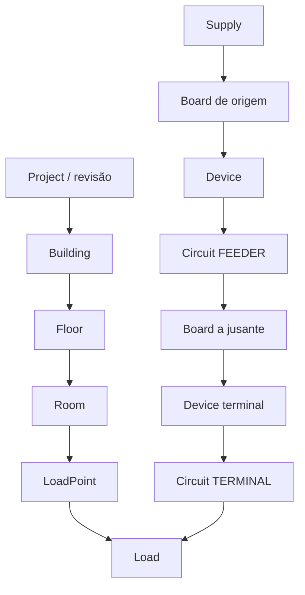

# F02 — Domínio canônico da instalação elétrica

Implementação: `restructuring/apps/api/sie_api/domain/installation.py`. Origem: tasks 02.01–02.05 e AC-02.01–AC-02.05 da story F02. O agregado valida identidade, unidades, referências e conectividade; não dimensiona condutores, seleciona dispositivos, interpreta normas ou concede homologação.

## Fronteiras de responsabilidade

| Contexto | Responsabilidade e fronteira |
|---|---|
| Projeto | `Project` identifica o agregado e sua revisão atual. A identidade não depende do nome exibido. |
| Cadastro espacial | `Building → Floor → Room → LoadPoint`; localização física separada da alimentação elétrica. Um circuito pode alimentar pontos em ambientes distintos. |
| Topologia elétrica | `Supply → Board → Device → Circuit → Load`; `Circuit(kind=FEEDER)` alimenta outro quadro. A validação ocorre no agregado do servidor. |
| Cargas | `Load` declara conexão e grandezas P, Q, S ou corrente de projeto. Não deriva automaticamente uma grandeza das demais. |
| Regras | Registro normativo e condições de aplicação permanecem fora deste agregado, nos módulos versionados existentes. O modelo não cria valores nem amplia o aceite do lote 01. |
| Cálculo | `CalculationRun` referencia revisão/circuito e versões de algoritmo/regra com hashes. O serviço de aplicação executa motores; o domínio canônico não depende deles. |
| Representação | Consome referências/snapshot da revisão; não é proprietária dos dados de engenharia nem executa seleção elétrica no navegador. |
| Documento | Consome a mesma revisão de projeto e cálculo. Emissão/persistência documental é responsabilidade externa a este módulo. |
| Usuário | Autenticação, autorização e identidade do titular pertencem à fronteira de aplicação; não são inferidas do `project_id`. Este módulo não implementa RBAC. |
| Auditoria | Revisões, identidades e hashes permitem vincular evidências. Persistência, autoria autenticada, eventos e política de retenção pertencem ao serviço/repositório correspondente. |

O módulo importa somente biblioteca padrão e Pydantic. Não importa FastAPI, storage, SQLite, Supabase, interface ou motores legados.

## Relações



A localização de `Board` é `room_id`; sua alimentação é `supply_id` ou um alimentador de entrada, nunca ambos. O desenho representa relações, não constitui um unifilar emitido nem uma decisão de proteção.

## Entidades e referências

Todas as entidades possuem `id: UUID`, `project_id: UUID` e `name`. `Project` possui `id`, `name` e `revision` inteira positiva. UUIDs são únicos em todo o agregado, incluindo a identidade do projeto. `Floor.building_id`, `Room.floor_id`, `Board.room_id` e `LoadPoint.room_id` estabelecem a hierarquia espacial.

`Supply` exige frequência e pelo menos uma tensão nominal explicitamente declarada. `voltage_fn` aceita somente base FN e `voltage_ff` somente FF. Não se presume relação matemática entre os dois valores, esquema de aterramento ou transformação de tensão.

`Circuit` exige quadro de origem, dispositivo do mesmo quadro, corrente de projeto e tensão. `phases=1` é o valor contratual padrão; `phases=3` exige tensão FF. Um terminal exige uma ou mais cargas e não admite quadro a jusante; um alimentador exige quadro a jusante e não admite lista de cargas terminais. A conexão das cargas deve corresponder às fases/base do circuito. A tensão de cada circuito deve corresponder à tensão da fonte ancestral para aquela base; não existe entidade transformador nesta versão e, portanto, não se admite transformação implícita.

Cada quadro tem exatamente uma alimentação. O grafo de quadros é acíclico e todos os dispositivos, cargas e fontes devem participar da topologia. Uma carga não pertence a dois circuitos e um dispositivo não origina dois circuitos. As referências existem no mesmo agregado e projeto. A detecção de ciclos usa ordenação topológica sem recursão.

`CableRun` referencia um circuito e uma lista ordenada, não vazia e sem repetições de segmentos. Declara seção, material e isolação; cada circuito exige ao menos um percurso. `Segment` referencia seu percurso e possui comprimento e `InstallationConditions` próprios. Não há um fator de correção global presumido. Método, meio, temperatura ambiente, quantidade de circuitos agrupados e exposição solar são explícitos; temperatura do condutor, condições adicionais e impedância podem ser declaradas. Cada segmento pertence exatamente ao percurso que o lista.

`Revision` tem sequência positiva única e hash de entrada; seu pai, se informado, precisa precedê-la, e nenhuma sequência pode exceder a revisão atual do projeto. `CalculationRun` referencia revisão e circuito, declara `project_revision`, versões de algoritmo/regra e hashes. Estado `VALID` exige `output_sha256`; ele significa estado do registro, não conformidade normativa (`normative_conformity_verified=false`). O serviço de aplicação trata snapshot, alterações e invalidação dos resultados.

Um projeto inteiramente vazio pode representar um rascunho; entidades elétricas parcialmente desconectadas são recusadas. Ambientes sem ponto/carga podem existir como cadastro espacial.

## Grandezas e serialização

| Grandeza | Contrato explícito |
|---|---|
| Tensão | `{value: "220", unit: "V", basis: "FN" ou "FF"}` |
| Corrente | `{value: "20", unit: "A"}` |
| Potência ativa P | `{value: "1000", unit: "W"}` |
| Potência reativa Q | `{value: "-100", unit: "var"}`; sinal declarado, sem inferência |
| Potência aparente S | `{value: "1200", unit: "VA"}` |
| Comprimento | `{value: "12.5", unit: "m"}` |
| Seção | `{value: "4", unit: "mm2"}` |
| Temperatura | `{value: "30", unit: "degC"}`; acima do zero absoluto |
| Impedância por comprimento | `resistance`, `reactance`, `unit: "ohm/km"`, frequência, temperatura do condutor e fonte declarada |

A entrada da magnitude aceita texto decimal ou `Decimal`; recusa float binário, inteiro, booleano, NaN e infinito. Não converte kW em W nem centímetros em metros silenciosamente. Todas as unidades são literais validadas. Valores positivos/não negativos são impostos conforme a dimensão; Q e reatância mantêm sinal declarado. `model_dump(mode="json")` e `model_dump_json()` serializam Decimal como texto, preservando precisão. `extra="forbid"` recusa campos desconhecidos em cada contrato.

## Uso e validação

```python
from sie_api.domain.installation import Installation

installation = Installation.model_validate(payload)
serialized = installation.model_dump(mode="json")
restored = Installation.model_validate_json(installation.model_dump_json())
```

O agregado deve ser reconstruído/validado ao receber alterações; modificar listas aninhadas em memória não constitui validação de uma nova revisão. O snapshot por valor/hash é responsabilidade de `installation_service.py` e não transforma este modelo em persistência durável.

`tests/test_installation_f02.py::demo_installation()` oferece cenário sintético reproduzível: um alimentador entre dois quadros e dois circuitos terminais no quadro a jusante, com duas cargas, uma por circuito terminal; o primeiro percurso terminal possui dois segmentos com condições distintas. Os identificadores e números são dados de teste, sem referência normativa.

A suíte cobre ida/volta JSON, precisão, unidades incompatíveis, não finitos, referências órfãs, projeto cruzado, identidade duplicada, ciclos, alimentação duplicada/ausente, base/tensão ancestral divergente, condições por segmento, referências de revisão, cargas compartilhadas e exigência de hash para cálculo válido. Evidências finais de execução/CI constam no relatório da F02.


## Ajustes verificados após QA

Supply.phases é obrigatório (inteiro1ou3). Nenhum circuito pode exigir mais fases que a fonte e os alimentadores ancestrais; não há conversor implícito. Frequência de impedância declarada é comparada com a fonte ancestral. Magnitudes possuem limite de recurso de1000dígitos e expoente absoluto1000, sem atribuição normativa. Duas cargas/circuitos terminais no mesmo quadro e um alimentador entre quadros constam no exemplo executável `restructuring/examples/f02_instalacao_demo.json`.
