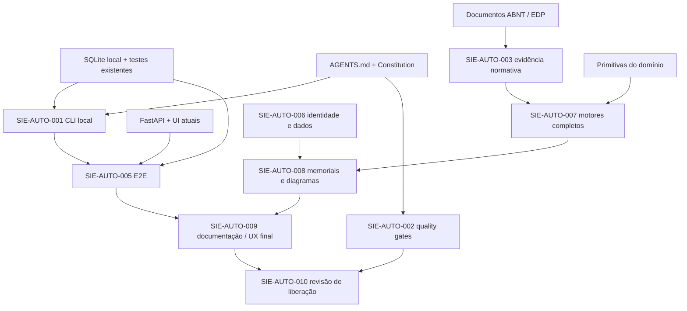

# DEPENDENCY_GRAPH — dependências verificáveis

## Dependências inspecionadas
- SQLite (`sie_api/storage.py`) opera sem API e sem rede: predecessor real de CLI.
- API opcional (`storage_api.py`) opera com token local e não é identidade de produção.
- `domain/engines.py` implementa exemplos resistivos; evidências normativas completas não são demonstradas por essas funções.
- Fonte EDP registrada em `Arquivos_Diversos/QA_CONFERENCIA_CERTFID_TABELAS_EDP.md`, com lacunas de abrangência declaradas pelo documento; catálogo técnico não é elegibilidade aprovada.
- O gate normativo não pode migrar para APROVADO por simples entrada da UI.

## Política de transição
Somente promover PREDECESSOR a satisfeito quando houver arquivo verificável + testes adequados. Mocks, exemplos e tabelas provisórias **não** satisfazem gates normativos.
