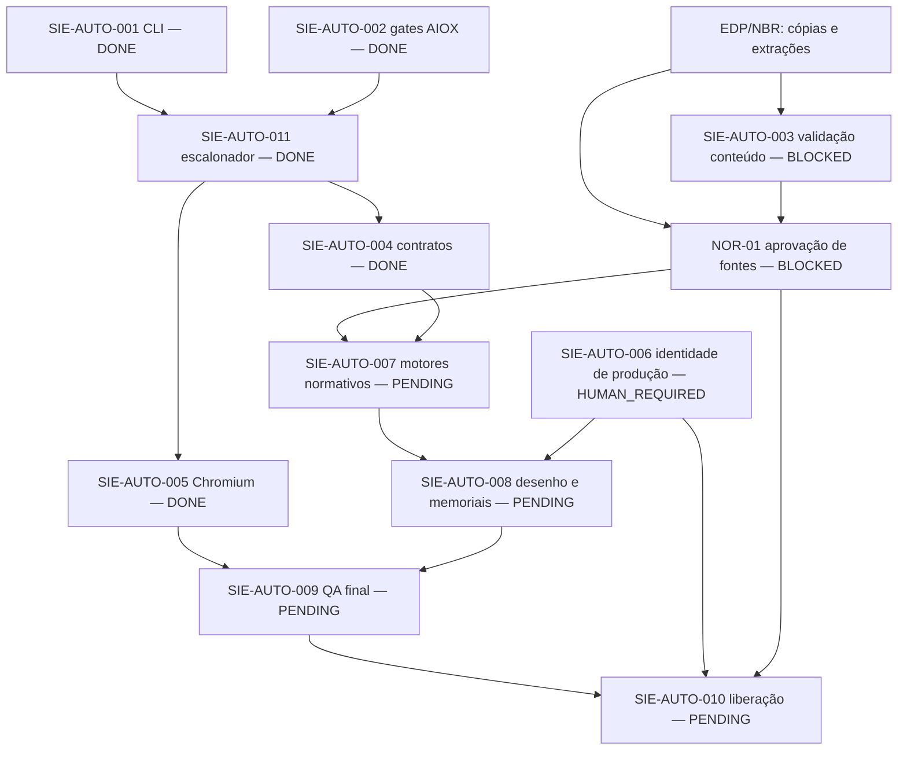

# DEPENDENCY_GRAPH — dependências verificáveis

## Dependências observadas

- CLI e testes locais não dependem de navegador ou Supabase.
- Chromium reproduziu a jornada atual (3 E2E pass), mas não comprova que os dados normativos estão certos.
- As primitivas de dimensionamento atualmente utilizam tabelas informadas pelo cliente e modelos resistivos ilustrativos.
- O inventário SHA256 tem seis artefatos presentes, porém `normative_conformity_verified=false`; não satisfaz NOR-01.
- A autorização de ambiente/identidade de produção permanece fora do escopo seguro da sessão.
- Nenhuma tarefa com requisitos faltantes será promovida para READY por mera presença de mock, PDF ou documento de planejamento.

## Política de transições

`ORCHESTRATOR_STATE.json` é fonte canônica de estados. `scheduler.py` verifica dependências, ciclos, condições de DONE e evidência registrada; a veracidade das evidências exige conferência externa. As transições registram o motivo, mas não executam agentes em segundo plano.

## Auditoria F00 — registro separado

F00 é uma fase inicial sem dependência de fase anterior. Seu estado está no mesmo JSON canônico; o fechamento do inventário não altera as dependências técnicas do grafo acima. A sequência de fases será consumida por artefatos próprios, sem inferir aprovação de motores ou produção pela F00.
