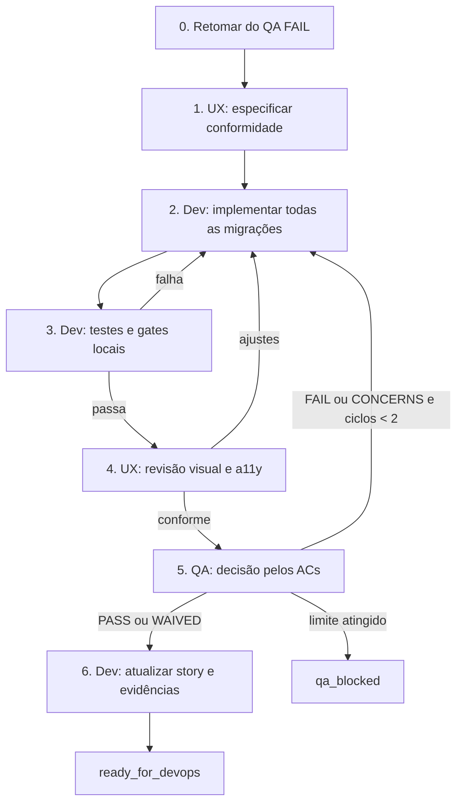

# Workflow SDC automático YOLO — Retomada SIE-UX-01

**ID:** `sdc-yolo-retomada-sie-ux-01`  
**Modo:** YOLO local, sem prompts entre fases  
**Story:** [`story-SIE-UX-01-padronizacao-headers-sie.md`](../stories/story-SIE-UX-01-padronizacao-headers-sie.md)  
**Plano de origem:** [`PLANO-PADRONIZACAO-HEADERS-SIE.md`](../ux/PLANO-PADRONIZACAO-HEADERS-SIE.md)  
**Contrato base:** [`WORKFLOW-SDC-YOLO-EXECUCAO-SIE-UX-01.md`](./WORKFLOW-SDC-YOLO-EXECUCAO-SIE-UX-01.md)

## Objetivo

Retomar a SIE-UX-01 a partir do resultado QA `FAIL`, concluindo a padronização de headers sem ampliar o escopo funcional. A execução distribui a implementação ao `@aiox-dev`, a conformidade visual ao `@aiox-ux-design-expert` e a decisão de qualidade ao `@aiox-qa`.

## Limites e autoridade

- O escopo é exclusivamente o definido nos critérios de aceite da SIE-UX-01.
- Não alterar cálculos, APIs, domínio, permissões, feature flags, nomes, handlers ou disponibilidade das ações existentes.
- `@aiox-dev` implementa, testa e corrige o código.
- `@aiox-ux-design-expert` define e aprova a aplicação do design system e a acessibilidade visual.
- `@aiox-qa` emite o veredito de qualidade; nenhum outro agente o substitui.
- Operações remotas são proibidas nesta execução. Apenas `@aiox-devops` pode executar push, PR, merge, release, deploy ou rollback mediante autorização em nova execução.

## Manifesto imutável

```yaml
run_id: "sdc-yolo-retomada-sie-ux-01-<timestamp>"
story_path: "docs/stories/story-SIE-UX-01-padronizacao-headers-sie.md"
plan_path: "docs/ux/PLANO-PADRONIZACAO-HEADERS-SIE.md"
mode: "yolo"
start_state: "qa_fail_remediation"
max_remediation_cycles: 2
remote_operations:
  push_authorized: false
  pull_request_authorized: false
  merge_authorized: false
  release_authorized: false
  deploy_authorized: false
  rollback_authorized: false
```

O orquestrador registra o manifesto, seu fingerprint e o estado do worktree antes da Fase 0. Uma mudança de requisito ou de autorização encerra esta execução e exige novo manifesto.

## Fluxo automático



## Fases e handoffs

| Fase | Responsável | Execução YOLO | Critério de saída |
|---|---|---|---|
| 0. Retomada | `@aiox-master` | Ler story, plano, QA Results e alterações locais; preservar mudanças existentes e transformar os cinco achados do QA em checklist operacional. | Manifesto e backlog de remediação registrados. |
| 1. Conformidade UX | `@aiox-ux-design-expert` | Confirmar os tokens SIE, a referência visual, as variantes módulo/índice e o comportamento responsivo. Revisar a solução parcial sem redesenhar módulos técnicos. | Especificação de aplicação pronta para desenvolvimento. |
| 2. Implementação | `@aiox-dev` | Completar `SiePageHero`, remover duplicidades e migrar todas as rotas exigidas. Preservar ações, métricas, tags, toolbars e navegação contextual. | Todos os itens da matriz de rotas têm alteração e evidência. |
| 3. Verificação local | `@aiox-dev` | Criar/atualizar testes de renderização, hierarquia de headings e snapshots relevantes; executar os gates e CodeRabbit. | Todos os comandos obrigatórios aprovados e registrados. |
| 4. Revisão UX | `@aiox-ux-design-expert` | Verificar tipografia IBM Plex, tokens centralizados, contraste, foco, responsividade abaixo de 960px e ausência de estilos equivalentes inline. | Parecer `conforme` ou lista objetiva de correções. |
| 5. QA | `@aiox-qa` | Revalidar cada AC, incluindo Command Center habilitado e ausência de segundo `h1`. | `PASS`/`WAIVED`, ou retorno ao ciclo de correção. |
| 6. Registro | `@aiox-dev` | Atualizar checkboxes, Dev Agent Record, Completion Notes, File List e QA Results da story apenas com evidências reais. | Story pronta para revisão/DevOps. |

## Backlog obrigatório de remediação

O `@aiox-dev` só pode encerrar a Fase 2 depois de cobrir todos os itens abaixo:

1. Consolidar `SiePageHero`, suas variantes de módulo e índice, estilos e tokens centralizados.
2. Concluir Dependências, Planejador de circuitos e Queda de tensão, eliminando duplicidade entre header de página e header interno sem remover ações ou informações.
3. Migrar Padrão de entrada, Correntes, Dimensionamento de condutores, Unifilar interativo, Diagrama unifilar e Projetos.
4. Garantir um único `h1` por rota migrada; headers de workspace, painel e card devem ser `h2` ou inferiores.
5. Revisar o Command Center com a feature habilitada, preservando seus headers técnicos e a hierarquia existente.
6. Remover classes e estilos legados somente quando não possuírem consumidores.
7. Adicionar evidência reproduzível para viewport menor que 960px, foco por teclado e contraste WCAG AA.

## Gates bloqueantes

Executar na raiz de `sistema-de-instala-es-el-tricas-sie-main`:

```text
npm run lint
npm run typecheck
npm test
npm run build:spa
coderabbit --prompt-only -t uncommitted
```

Os testes devem comprovar `h1`, eyebrow opcional, descrição, ações, metadados e a hierarquia de headings das rotas migradas. Falha, timeout sem diagnóstico ou ausência de evidência equivale a gate reprovado e retorna à Fase 2.

## Política de correção

- Falha em implementação, UX ou gate local: `@aiox-dev` corrige e reexecuta as Fases 3 e 4.
- QA `FAIL` ou `CONCERNS`: incrementar `remediation_cycles`; se for menor que 2, retornar à Fase 2.
- Ao atingir dois ciclos sem `PASS` ou `WAIVED`: encerrar como `qa_blocked`, mantendo logs e achados na story.
- Lacuna de requisito ou conflito com a story: encerrar como `story_blocked`; não inferir requisito novo.
- Nenhuma publicação é realizada: sucesso local termina em `ready_for_devops`.

## Evidências mínimas de conclusão

- Diff e File List completos na story.
- Resultado textual de cada gate obrigatório.
- Referência dos testes adicionados/atualizados e de qualquer snapshot aprovado.
- Parecer de conformidade de UX e veredito QA por AC.
- Registro de responsividade, contraste, foco e Command Center habilitado.
- Status final `Ready for Review` somente após QA `PASS` ou `WAIVED`; caso contrário, manter `InProgress` com o estado de bloqueio documentado.

## Estados terminais

| Estado | Significado |
|---|---|
| `ready_for_devops` | Implementação, UX, QA e registro locais aprovados; sem operação remota. |
| `qa_blocked` | Dois ciclos de correção foram consumidos sem QA `PASS`/`WAIVED`. |
| `story_blocked` | A story ou o plano contém lacuna que exige decisão fora do escopo. |
| `manifest_invalid` | Paths, autoridade ou manifesto inválidos. |

## Início

```text
@aiox-master
*run-workflow story-development-cycle-headless-yolo continue --mode=engine

workflow_path: docs/workflows/WORKFLOW-SDC-YOLO-RETOMADA-SIE-UX-01.md
story_path: docs/stories/story-SIE-UX-01-padronizacao-headers-sie.md
mode: yolo
```

Este arquivo é operacional e não inicia uma operação remota.
