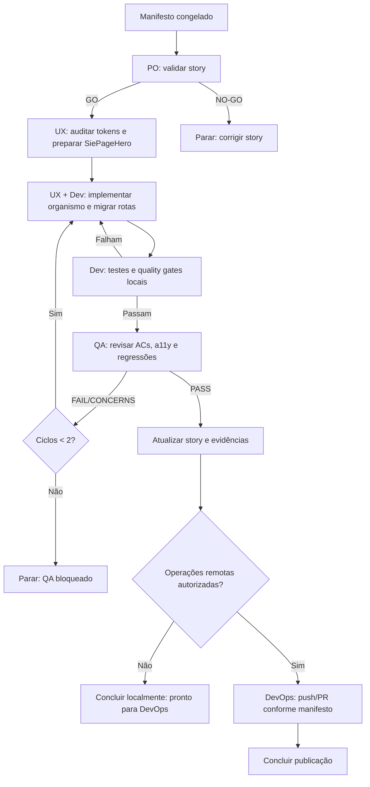

# Workflow SDC automático YOLO — SIE-UX-01

**Workflow ID:** `sdc-yolo-sie-ux-01`  
**Modo:** YOLO/headless (zero prompts após a validação do manifesto)  
**Story-alvo:** [`story-SIE-UX-01-padronizacao-headers-sie.md`](../stories/story-SIE-UX-01-padronizacao-headers-sie.md)  
**Contrato-base do framework:** `.aiox-core/development/workflows/story-development-cycle-headless-yolo.yaml`  
**Escopo:** implementar e validar a padronização de headers descrita na SIE-UX-01, sem alterar domínio, APIs, cálculos, permissões ou feature flags.

## Finalidade

Orquestrar automaticamente todas as fases necessárias para concluir a SIE-UX-01: validação da story, construção do organismo `SiePageHero`, migração das rotas, garantia de acessibilidade, testes, QA, publicação DevOps quando autorizada e atualização da própria story.

SDC significa **Story Development Cycle**. Este documento é um contrato operacional específico da story; ele reutiliza o ciclo headless existente em vez de criar um mecanismo de execução paralelo.

## Princípios YOLO

- Não solicitar confirmação entre fases após o manifesto estar validado.
- Persistir evidências e estado a cada checkpoint, permitindo retomada idempotente.
- Reexecutar automaticamente apenas o loop permitido `implementação → QA → correção`.
- Parar em bloqueios reais: story rejeitada, gate de qualidade reprovado repetidamente, requisito ausente ou operação externa sem autorização.
- Não criar requisitos visuais ou funcionais além da story e do plano UX referenciado.
- Somente `@devops` pode executar `push`, PR, merge, release ou deploy.

## Manifesto de execução

O executor deve congelar o manifesto antes de iniciar. O manifesto é imutável durante a execução; qualquer alteração gera uma nova execução.

```yaml
run_id: "sdc-yolo-sie-ux-01-<timestamp>"
story_path: "docs/stories/story-SIE-UX-01-padronizacao-headers-sie.md"
plan_path: "docs/ux/PLANO-PADRONIZACAO-HEADERS-SIE.md"
mode: "yolo"
max_qa_remediation_cycles: 2
remote_operations:
  push_authorized: false
  pull_request_authorized: false
  merge_authorized: false
  release_authorized: false
  deploy_authorized: false
  rollback_authorized: false
```

O usuário ou `@devops` deve alterar uma autorização remota em uma **nova** execução; o modo YOLO não amplia essa autoridade.

## Fluxo



## Fases e responsabilidades

| Fase | Agente responsável | Ação automática | Evidência obrigatória | Saída / falha |
|---|---|---|---|---|
| 0. Inicialização | `@aiox-master` | Validar manifesto, paths, permissões e estado anterior; gerar fingerprint. | `manifest_snapshot`, `manifest_fingerprint` | Falha: parar como `manifest_invalid`. |
| 1. Validação da story | `@po` | Validar a SIE-UX-01 contra seus ACs, escopo, riscos e critérios de pronto. | `story_validation` com `GO` ou `NO-GO` | `NO-GO`: parar; não implementar. |
| 2. Preparação UX | `@ux-design-expert` | Confirmar tokens existentes, definir o organismo reutilizável e preservar a semântica dos módulos. | inventário de tokens/consumidores e especificação do componente | Falha: retornar à validação de story somente se houver lacuna de requisito. |
| 3. Implementação | `@ux-design-expert` com revisão `@dev` | Criar `SiePageHero`, centralizar estilos/tokens e migrar as rotas da matriz da story. | diff local, testes do componente e lista de arquivos | Falha: corrigir no mesmo ciclo. |
| 4. Qualidade local | `@dev` | Executar testes de renderização, headings, snapshots aprovados, lint, typecheck, testes e build SPA. | logs dos comandos e resultado CodeRabbit pre-commit | Falha: retornar à Fase 3. |
| 5. QA | `@qa` | Verificar ACs, acessibilidade WCAG AA, responsividade, preservação de ações e regressões no Command Center. | `qa_verdict`: `PASS`, `FAIL`, `CONCERNS` ou `WAIVED` | `FAIL/CONCERNS`: retornar à Fase 3 até o limite. |
| 6. Registro | `@ux-design-expert` | Atualizar checkboxes, Completion Notes, File List e QA Results da story. | story atualizada | Falha: não concluir localmente. |
| 7. Publicação opcional | `@devops` | Executar pre-push, push e PR somente se as flags do manifesto estiverem verdadeiras. | `devops_report`, resultado de push/PR | Sem autorização: concluir como `ready_for_devops`; não é falha. |

## Cobertura obrigatória da implementação

A Fase 3 deve cobrir todos os itens da story, nesta ordem:

1. Consolidar tokens e construir `SiePageHero`, incluindo variante de módulo e variante de índice.
2. Migrar Dependências como rota piloto, sem remover “Nova dependência”.
3. Migrar Queda de tensão e Planejador de circuitos, preservando Tutorial, tags e toolbar operacional.
4. Migrar Padrão de entrada, Correntes, Dimensionamento, Unifilar interativo e Diagrama unifilar.
5. Migrar a variante de índice Projetos, sem remover métricas.
6. Revisar o Command Center habilitado, sem criar segundo `h1` e sem redesenhar seus headers internos.
7. Remover classes/estilos legados somente depois de não haver consumidores.

## Gates automáticos

| Gate | Critério de aprovação |
|---|---|
| Semântico | Um único `h1` por rota migrada; cabeçalhos internos em `h2` ou inferior. |
| Visual | Hero usa IBM Plex Sans, tokens centralizados e composição da referência aprovada. |
| Responsivo | Abaixo de 960px, conteúdo e ações ficam acessíveis em coluna. |
| Acessibilidade | Contraste WCAG AA, foco navegável e HTML/ARIA semântico. |
| Regressão funcional | Ações, handlers, rotas, métricas, tags e toolbars existentes continuam disponíveis. |
| Qualidade | `npm run lint`, `npm run typecheck`, `npm test` e `npm run build:spa` passam. |
| Revisão automatizada | CodeRabbit pre-commit é executado conforme a SIE-UX-01; issues CRITICAL entram no loop de correção. |

## Política de correção automática

- **Falha de implementação ou gate local:** retornar diretamente à Fase 3.
- **QA `FAIL` ou `CONCERNS`:** criar evidência de falha, corrigir na Fase 3 e reexecutar Fases 4 e 5.
- **Máximo de ciclos QA:** dois ciclos de correção após a primeira revisão. Ao exceder, encerrar como `qa_blocked` com evidências completas.
- **Story `NO-GO`:** encerrar como `story_blocked`; nenhuma mudança de código é iniciada.
- **Gate crítico externo:** encerrar como `pre_publication_blocked`; não iniciar publicação.
- **Falha após publicação autorizada:** somente `@devops` pode executar rollback, e apenas se `rollback_authorized: true` estiver no manifesto.

## Estados terminais

| Estado | Significado |
|---|---|
| `ready_for_devops` | Implementação e QA locais concluídos; nenhuma operação remota foi autorizada. |
| `published` | Push/PR executados por `@devops` com autorização explícita. |
| `manifest_invalid` | Manifesto, paths ou autoridade inválidos. |
| `story_blocked` | PO emitiu `NO-GO` para a story. |
| `qa_blocked` | Limite de correções atingido sem QA PASS. |
| `pre_publication_blocked` | Gate crítico falhou antes de publicação. |
| `rollback_completed` | Rollback autorizado e executado por `@devops`. |

## Checklist de encerramento

- [ ] Todos os 11 acceptance criteria da SIE-UX-01 foram verificados.
- [ ] As tarefas e subtarefas da story foram atualizadas.
- [ ] Completion Notes, File List e QA Results foram preenchidos.
- [ ] Evidências dos quality gates foram registradas.
- [ ] O estado terminal foi gravado com o fingerprint do manifesto.
- [ ] Nenhuma operação remota foi executada por agente que não seja `@devops`.

## Como iniciar

Usar o contrato headless existente como referência de execução e informar explicitamente a story e o manifesto da execução. O documento não autoriza operações remotas por si só.

```text
@aiox-master
*run-workflow story-development-cycle-headless-yolo start --mode=engine

Manifesto: sdc-yolo-sie-ux-01-<timestamp>
Story: docs/stories/story-SIE-UX-01-padronizacao-headers-sie.md
Modo: yolo
```

## Referências

- [`docs/stories/story-SIE-UX-01-padronizacao-headers-sie.md`](../stories/story-SIE-UX-01-padronizacao-headers-sie.md)
- [`docs/ux/PLANO-PADRONIZACAO-HEADERS-SIE.md`](../ux/PLANO-PADRONIZACAO-HEADERS-SIE.md)
- `.aiox-core/development/workflows/story-development-cycle-headless-yolo.yaml`
- `.aiox-core/development/workflows/story-development-cycle.yaml`
