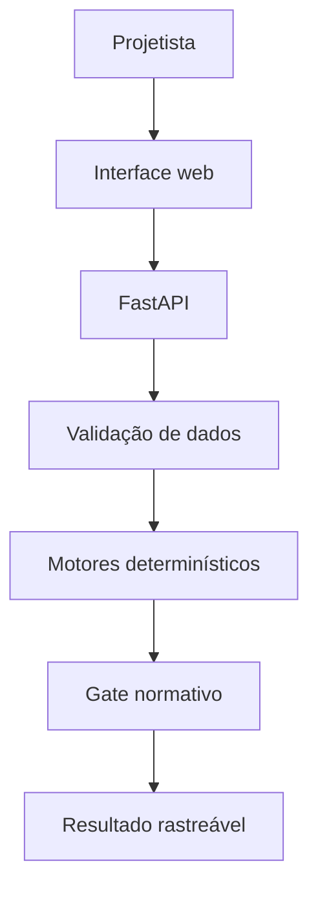

# Arquitetura integrada — SIE 2.0

## Objetivo

Entregar uma base local, explicável e progressivamente auditável para projetos elétricos. A arquitetura evita que uma decisão de engenharia seja apresentada como conforme à norma sem evidência, testes e revisão apropriados.

## Componentes

| Componente | Responsabilidade | Estado atual |
|---|---|---|
| `apps/web` | jornada, formulários, feedback e visualização | implementado |
| `apps/api/main.py` | contrato HTTP e validação de entrada | implementado |
| `domain/engines.py` | cálculo puro e testável | implementado no escopo declarado |
| `domain/gates.py` | impede alegação normativa prematura | implementado |
| persistência | projetos, catálogo versionado, auditoria | próxima etapa |
| importação/desenho | planta, cargas, unifilar e relatórios | próxima etapa |

## Contrato de análise

`POST /api/v1/circuitos/analisar` recebe os dados do circuito, tabela de condutores e evidência. A resposta sempre traz:

- resultados e critérios utilizados;
- fórmula de queda de tensão;
- evidência informada;
- `status_engenharia` e `liberado_para_uso_normativo`.

Assim, o produto pode calcular e explicar sem confundir estimativa técnica com aprovação normativa.

## Regras implementadas

| Motor | Regra | Falha segura |
|---|---|---|
| Condutor | `Iz_base × fator ≥ Ib` | recusa tabela insuficiente ou fator inválido |
| Disjuntor | `Ib ≤ In ≤ Iz` | recusa circuito sem disjuntor comercial compatível |
| Queda | `ΔV = 2 × L(km) × I × R` | recusa valores não positivos ou não finitos |
| Gate | fonte + edição + referência + dados validados + teste independente | bloqueia/pendencia a liberação |

## Evolução controlada

1. Versionar catálogos e fatores em banco, com autor, fonte, vigência e revisão.
2. Criar casos de referência auditados por cenário e norma.
3. Adicionar cálculo trifásico, impedância, curto-circuito, proteção, seccionamento e DR apenas após os respectivos testes.
4. Persistir projetos e gerar relatório/exportação com trilha de auditoria.
5. Integrar planta, cargas e diagrama unifilar no mesmo contrato de domínio.
